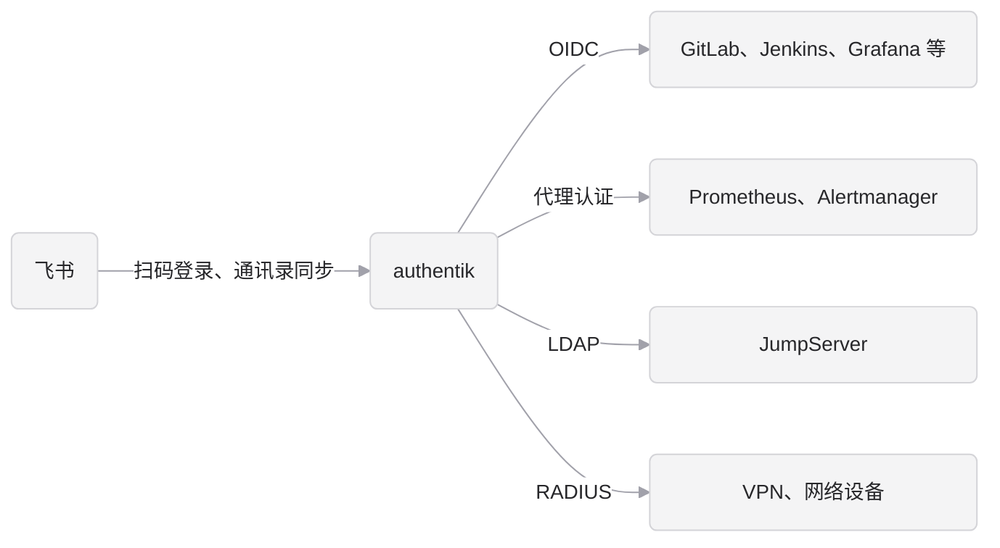

# iam-passport

公司统一身份平台（IAM）的部署配置和工具。员工用一个账号登录公司所有系统，入职自动开通，离职自动禁用。

- **身份中心**：[authentik](https://goauthentik.io/)，提供单点登录（OIDC、SAML）、LDAP、RADIUS 和代理认证。
- **人员来源**：飞书通讯录。员工用飞书扫码登录，同步脚本把组织架构同步到 authentik。



## 目录结构

```text
iam-passport/
├── Makefile            # make lint / chart / mirror / image-feishu-sync
├── deployments/        # 生产部署：Helm chart、Jenkinsfile、集群初始化、Dockerfile、authentik 版本号
├── authentik/          # 本地验证用的 compose 文件和 .env 模板
├── outposts/           # 本地验证用的 outpost 部署文件
│   └── ldap/           # LDAP outpost（给 JumpServer 等只支持 LDAP 的系统用）
├── org-sync/           # 组织架构同步，每个来源一个子目录
│   ├── common/         # 各来源共用：authentik 客户端、带重试的 HTTP 请求
│   └── feishu/         # 飞书通讯录 -> authentik
└── docs/
    ├── authentik.md    # 设计与安全规范：架构、加固、权限、应急、上线检查清单
    ├── authentik-deploy.md # 部署与运维：在阿里云 Kubernetes 上部署、发布、升级、监控、备份
    ├── integrations.md # 系统接入：账号迁移、OIDC 配置约定、自研系统、LDAP、RADIUS
    └── feishu.md       # 飞书扫码登录和通讯录同步
```

## 本地快速体验

需要 Docker 和 Docker Compose。

```bash
cp authentik/.env.example authentik/.env
sed -i '' "s|^PG_PASS=.*|PG_PASS=$(openssl rand -base64 36 | tr -d '\n/+=')|" authentik/.env
sed -i '' "s|^AUTHENTIK_SECRET_KEY=.*|AUTHENTIK_SECRET_KEY=$(openssl rand -base64 60 | tr -d '\n/+=')|" authentik/.env
make up
```

`sed -i ''` 是 macOS 的写法，Linux 上去掉 `''`。authentik 的版本只在 `deployments/chart/Chart.yaml` 里写一处，`make up` 会读出来写到 `authentik/.env`，本地和生产始终是同一个版本。

启动约需 1 分钟，然后打开 <http://localhost:9000/if/flow/initial-setup/> 设置管理员 `akadmin` 的邮箱和密码（路径末尾的 `/` 不能省）。

常用命令（在 `authentik/` 目录下）：

```bash
docker compose ps                                   # 查看状态
docker compose logs -f server worker                # 查看日志
docker compose exec worker ak create_recovery_key 10 akadmin   # 忘记管理员密码时，生成一次性恢复链接
docker compose down                                 # 停止，数据保留
docker compose down -v && rm -rf data               # 清空，从头再来
```

## 飞书通讯录同步

脚本把飞书通讯录同步到 authentik：入职建号，部门变成用户组，离职或冻结禁用账号。

```bash
cd org-sync
python3 -m venv .venv && . .venv/bin/activate && pip install -r requirements.txt
export FEISHU_APP_ID=cli_xxx FEISHU_APP_SECRET=xxx
export AK_URL=http://localhost:9000 AK_TOKEN=xxx
python3 -m feishu.main --dry-run   # 只打印将要做的变更，不写入
```

本地 API token 的创建、环境变量的设置和运行后怎么检查结果，见 [docs/feishu.md 4.1 节](docs/feishu.md#41-本地运行同步脚本)；飞书应用的创建和扫码登录配置见同一篇文档。

## 生产部署

生产环境用 authentik 官方 Helm chart 部署在阿里云 Kubernetes（ACS 或 ACK）上，使用专用 namespace `iam-passport-prod`，不设单独的测试环境。`deployments/chart/` 把官方 chart、飞书同步和 blueprints 打包成一个 Helm release，由 Jenkins 流水线发布。LDAP 等 outpost 由 authentik 自己在集群里创建和升级。

运维搭建从 [docs/authentik-deploy.md](docs/authentik-deploy.md) 开始，文档开头有完整的搭建顺序。

## 文档

按角色挑着读，不需要从头读完：

| 你要做的事 | 先读 | 需要时再读 |
|---|---|---|
| 评审方案、决定能不能上线 | [authentik.md](docs/authentik.md) 第 1、7 节和第 10 节的检查清单 | [feishu.md](docs/feishu.md) 第 6 节的风险 |
| 搭建和运维生产环境 | [authentik-deploy.md](docs/authentik-deploy.md) 开头的搭建顺序 | [authentik.md](docs/authentik.md) 第 3 节的安全加固 |
| 配置飞书扫码和通讯录同步 | [feishu.md](docs/feishu.md) | |
| 把 GitLab、Jenkins 等系统接入 authentik | [integrations.md](docs/integrations.md) 第 1 到 3 节 | |

OIDC 的原理（授权码流程、令牌、scope）不在这里重复，见博客 [authentik 统一身份认证 · OIDC](https://cylshao.com/posts/authentik-oidc/)。

各篇的内容：

- [docs/authentik.md](docs/authentik.md)：设计与安全规范。总体架构、部署约束、安全加固、权限设计、离职处理、高可用与应急、审计合规和上线检查清单。
- [docs/authentik-deploy.md](docs/authentik-deploy.md)：部署与运维。准备工作、首次部署、飞书同步和 LDAP outpost 的启用，以及发布、升级、回滚、监控、配置管理、备份、登录页品牌和应急发布。
- [docs/integrations.md](docs/integrations.md)：系统接入。接入顺序、已有账号的迁移、OIDC 的配置约定和验收、Grafana、自研系统、代理认证、LDAP、RADIUS。
- [docs/feishu.md](docs/feishu.md)：飞书扫码登录和通讯录同步的配置、风险和上线检查清单。

## 当前状态

- authentik 2026.8.5 已在本地 Docker 上验证可以启动和登录。
- 飞书扫码登录和通讯录同步已在本地 authentik 上用真实飞书租户验证。同步脚本没有自动化测试，修改后先在本地用 `--dry-run` 对照真实通讯录检查输出。
- 本地验证用的 LDAP outpost 部署文件已编写，配置校验通过，但还没有连接 authentik 实际运行过。
- Helm chart 已通过 `helm lint` 和 Kubernetes 1.31 的 schema 校验，还没有在集群上部署过；集群、数据库、域名、GitLab 地址等还是占位项，上线前要替换的完整清单见 [docs/authentik-deploy.md 3.1 节](docs/authentik-deploy.md#31-上线前需要替换的占位项)。
- 第一个 blueprint（只允许同步的账号扫码登录）已在本地 authentik 上验证。Grafana 试点配置尚未编写。

## 安全提示

- 不要提交 `.env`、`authentik/data/` 等文件，`.gitignore` 已排除。
- 生产环境不要使用本地生成的密钥，要重新生成并加密保存。
- 恢复链接等同于管理员登录权限，用完即弃，不要发到群里。

## 许可证

[Apache License 2.0](LICENSE)。authentik、GitLab 等依赖各自遵循其许可证，本仓库只使用它们的官方镜像，不包含其源码。
