# authentik 设计与安全规范

本文说明 authentik 统一身份平台在设计和安全上的规定：总体架构、部署约束、安全加固、权限、离职、高可用与应急、审计，以及上线前的检查清单。适用于 500 到 1000 人、使用飞书作为组织架构来源的场景。

- 部署、发布、升级、备份、监控等操作步骤见 [authentik-deploy.md](authentik-deploy.md)。
- 各业务系统怎么接入 authentik 见 [integrations.md](integrations.md)。
- 飞书扫码登录和通讯录同步见 [feishu.md](feishu.md)。

基于 authentik 2026.8.5 编写。升级到新版本前，先对照官方 [Release Notes](https://docs.goauthentik.io/releases/) 检查本文内容是否仍然适用。

## 1. 总体架构

authentik 是统一身份中心，飞书是人员信息的唯一来源：

- 员工用飞书扫码登录 authentik。
- 同步脚本每 10 分钟把飞书通讯录同步到 authentik：入职自动建号，部门自动变成用户组，离职或冻结自动禁用。
- 各业务系统按自己支持的协议接入 authentik。

```mermaid
---
config:
  theme: base
  themeVariables:
    primaryColor: "#f4f4f5"
    primaryBorderColor: "#d4d4d8"
    primaryTextColor: "#27272a"
    lineColor: "#a1a1aa"
    edgeLabelBackground: "#ffffff"
    fontSize: 14px
  flowchart:
    curve: basis
    padding: 16
---
flowchart LR
    FS("飞书（人员信息来源）") -->|扫码登录| AK("authentik 统一身份中心")
    FS -->|同步脚本：建号、部门组、离职禁用| AK
    AK -->|OIDC| WEB("<div style='width:19em'>GitLab、Jenkins、Harbor、Grafana、自研系统</div>")
    AK -->|代理认证| MON("<div style='width:19em'>Prometheus、Alertmanager</div>")
    AK -->|LDAP| JS("<div style='width:19em'>JumpServer 社区版</div>")
    JS --> SRV("服务器、数据库")
    AK -->|RADIUS| VPN("<div style='width:19em'>VPN、网络设备</div>")
```



接入方式的对比：

| 方式 | 员工怎么登录 | 能飞书扫码 | authentik 的二次 MFA | 系统能拿到员工密码 | 额外组件 | 典型系统 |
|---|---|---|---|---|---|---|
| OIDC | 浏览器跳到 authentik 登录后跳回 | 能 | 能 | 不能 | 无 | GitLab、Grafana、Jenkins、Harbor、Argo CD、自研系统 |
| SAML | 同 OIDC | 能 | 能 | 不能 | 无 | 只支持 SAML 的商业软件 |
| 代理认证（Proxy provider） | 访问系统时先被拦到 authentik 登录 | 能 | 能 | 不能 | 反向代理加 outpost（可用内置的） | Prometheus、Alertmanager 等没有登录功能的页面。只能控制能否访问，系统里不区分角色 |
| LDAP | 在系统的登录框里输入用户名和 authentik 密码 | 不能 | 不能，靠系统自己的 MFA | 能 | LDAP outpost | 只支持 LDAP 的老系统，如部分版本的 JumpServer |
| RADIUS | 在客户端输入用户名和密码，需要动态码时拼在密码后 | 不能 | 只能用拼接的动态码 | 能 | RADIUS outpost | VPN、交换机等网络设备。密码认证只支持 PAP |

服务器和数据库不直接接入，统一通过 JumpServer 登录，不给个人开服务器账号。

按下面的顺序，选系统支持的第一种：

1. **OIDC**：首选，见 [integrations.md 第 3 节](integrations.md#3-oidc)。
2. **SAML**：系统只支持 SAML 时。两者都支持时选 OIDC，配置和排查更简单。
3. **代理认证**：系统没有登录功能，且不需要区分角色，见 [integrations.md 第 5 节](integrations.md#5-代理认证prometheusalertmanager)。
4. **LDAP**：系统只支持 LDAP 时，见 [integrations.md 第 6 节](integrations.md#6-jumpserverldap)。
5. **RADIUS**：只用于 VPN 和网络设备，见 [integrations.md 第 7 节](integrations.md#7-vpn-和网络设备radius)。

越往后，飞书扫码和 authentik 的 MFA 越用不上，员工也越需要单独的密码。用 LDAP 或 RADIUS 的员工，要先扫码登录 authentik，在个人设置里设置密码；这个密码只能用于 LDAP 和 RADIUS，在 authentik 登录页用密码登录仍会被拒绝，除非在 `密码登录例外` 组里，见第 3 节。

**authentik 是全公司所有系统的登录入口。** 它一旦不可用，所有人都登录不了任何系统，包括要去修复它的运维人员。第 7 节专门说明高可用和应急通道，上线前必须落实。

## 2. 部署约束

生产环境用 authentik 官方 Helm chart 部署在阿里云 Kubernetes 上，只有生产一个环境，使用专用 namespace。资源规格、部署文件和操作步骤都在 [authentik-deploy.md](authentik-deploy.md)，这里只说明设计上必须遵守的几点。

**容量**：server 2 核 4 GB × 2、worker 1 核 2 GB × 2、RDS 2 核 4 GB 起，对 1000 人很宽裕。官方最低要求是 2 核 2 GB，当前版本不依赖 Redis。按目录价估算每月约 1300 到 1550 元，最终以公司折扣为准，明细见 [authentik-deploy.md 附录 B](authentik-deploy.md#附录-b-成本估算)。

**多副本**：

- 所有 server 和 worker 使用同一个 `AUTHENTIK_SECRET_KEY`，否则会话和加密数据在副本间不通用。它们读取同一个 Secret。
- 上传的文件存在容器的 `/data` 目录，多副本时只在上传时所在的那个 Pod 上可见。生产环境不挂共享存储，**不在后台上传文件**，图片用 OSS 或 CDN 的 URL。
- server、worker 和 outpost 的版本必须一致。server 和 worker 由 Helm chart 一起发布，outpost 由 authentik 自动升级到相同版本。

**关键配置**（都已写在 `deployments/chart/` 的 values 文件里）：

| 配置项 | 说明 |
|---|---|
| `AUTHENTIK_SECRET_KEY` | 在 Secret 里。泄露后必须更换，而更换会让所有会话失效 |
| `AUTHENTIK_WEB__BASE_URL` | authentik 的访问地址，2026.11 起为必填项 |
| `AUTHENTIK_LISTEN__TRUSTED_PROXY_CIDRS` | 信任哪些地址发来的 `X-Forwarded-For`。设置后会覆盖默认的内网网段，所以要把内网网段一起写上。配错时 authentik 会把负载均衡的地址当作用户 IP，审计日志、GeoIP 策略和登录频率限制都会失效 |
| `AUTHENTIK_ERROR_REPORTING__ENABLED` | `false`，不向外部上报错误信息 |

### 2.1 不要做的事

- 不要给 worker 挂载 Docker socket，也不要给它集群级别的权限。worker 一旦被攻破，攻击者就能控制宿主机或集群。生产环境的 worker 只能操作 IAM 自己的专用 namespace（用来创建和升级 outpost），这个 namespace 里只有 IAM 的资源，所以不会扩大影响范围。这也是 IAM 必须使用专用 namespace 的原因之一。
- 不要使用抢占式实例（`compute-qos-strategy`），实例被回收时全公司都无法登录。
- 不要复用本地验证时生成的密钥，生产环境的密钥要重新生成。
- 不要把 `.env` 或任何密钥提交到仓库。

### 2.2 访问范围：内网还是公网

上线前要决定 authentik 的域名是否开放到公网：

| 方案 | 优点 | 代价 |
|---|---|---|
| 只在内网开放 | 攻击面小 | 员工在外面必须先连 VPN。而 VPN 认证也依赖 authentik，故障时形成死循环，必须有第 7 节的应急通道 |
| 开放到公网 | 员工在任何地方都能登录 SaaS 和对外系统 | 前面要加 WAF 和登录频率限制，并强制 MFA |

不要指望靠封锁 `/if/admin/` 路径来保护管理后台：它只是一个前端页面，所有管理操作都走 `/api/v3/`，而普通员工登录也要用这个接口，没法按路径区分。管理权限靠管理员账号强制 MFA（第 3 节和 5.1 节）和管理员人数控制来保证。开放到公网时，在 WAF 上额外限制 `/api/v3/` 的请求频率。

## 3. 安装后的安全加固

安装完成后马上处理。下面多处要求 MFA，MFA 和 TOTP 是什么、员工怎么绑定，见 3.4 节。

1. 给 `akadmin` 开启 MFA，并删除 Secret 里的初始密码，步骤见 [authentik-deploy.md 第 4 节](authentik-deploy.md#4-首次部署)。
2. 另建一个应急管理员账号，用本地密码加 MFA。用户名不要用常见英文名，避免和员工重名（重名时同步脚本会给员工的用户名加数字，员工容易混淆）。
3. 密码登录的规则由 blueprint `password-login-exceptions.yaml` 配置，随 Helm chart 发布，不要在后台手工修改：

   | 账号 | 飞书扫码 | 密码登录 |
   |---|---|---|
   | 同步脚本建的员工账号 | 可以 | 拒绝，提示用飞书扫码 |
   | 员工账号，且在 `密码登录例外` 组里 | 可以 | 可以，必须过 MFA |
   | `akadmin`、应急管理员等手工账号 | 拒绝（`feishu-only-managed-users.yaml`） | 可以，必须过 MFA |

   密码登录时，已经绑定 MFA 设备的人校验动态码；还没绑定的人要先当场绑定 TOTP 才能登录。所以把员工加进例外组后，让他马上扫码登录、设置密码并绑定 MFA，不要让只有密码、还没绑 MFA 的状态拖着。

   例外组只给两类人：飞书故障时要能登录的关键岗位（见 [feishu.md 6.2 节](feishu.md#62-飞书故障的影响)），以及确实要用只支持密码的系统的人。成员由管理员手工维护，blueprint 不会改动。

   这条规则只作用于登录页（`default-authentication-flow`）。飞书扫码走 `default-source-authentication`，不受影响；LDAP、RADIUS 走各自的 bind flow，也不受影响，见 [integrations.md 第 6 节](integrations.md#6-jumpserverldap)。
4. 在系统设置里关闭“允许用户修改姓名、邮箱、用户名”，资料统一以飞书为准。不关的话，用户改了也会被同步脚本覆盖。
5. 管理员账号的邮箱和密码要准确记录在公司的密码管理工具里。
6. 在 System → Settings 里把 Avatars 改成 `attributes.avatar,initials`：有飞书头像（同步脚本写在账号的 `avatar` 属性里）就用飞书头像，没有就显示姓名首字母。不要用默认的 `gravatar`，国内访问慢，还会把邮箱的哈希发给外部服务。通过 OIDC 接入的系统能从 `profile` scope 的 `picture` 拿到头像地址，但 GitLab 不读这个字段，仍显示自己的默认头像。
7. 配置防止扫码冒用手工账号的策略，并落实飞书账号安全要求，见 [feishu.md 3.5 节和 6.1 节](feishu.md#35-防止扫码冒用手工账号)。

### 3.1 会话和密码策略

- **会话时长**：在登录流程的 User Login 步骤里明确设置 authentik 的会话有效期，比如 8 到 12 小时，不要依赖默认值。管理员可以单独设得更短。
- **密码策略**：例外组的员工，以及用 JumpServer、VPN（LDAP、RADIUS 接入）的员工，需要单独设置 authentik 密码。给密码修改流程配置密码强度策略（长度、复杂度，可开启泄露密码检查）。
- **LDAP 和 RADIUS 只能做密码认证**：所以 JumpServer 自身的 MFA 必须开启；VPN 需要动态码时按 [integrations.md 第 7 节](integrations.md#7-vpn-和网络设备radius) 的格式输入。
- **时间同步**：所有 authentik 节点、outpost 和下游系统都要开启 NTP。时间不准会导致 MFA 动态码和 token 校验失败。

### 3.2 管理员账号的使用规则

- `akadmin` 和应急管理员只用于管理和应急，日常不使用。
- 管理员本人日常用飞书扫码登录自己的账号，例如 `david`。需要管理权限时，把这个账号加入 `authentik Admins` 组。
- 管理员离职时，要同时检查 `authentik Admins` 组和所有服务账号的 token。
- 管理员人数控制在 2 到 3 人，每季度复核一次 `authentik Admins` 组成员。

### 3.3 恢复链接

忘记管理员密码时，生成一次性恢复链接（参数 10 是有效分钟数）：

```bash
kubectl -n iam-passport-prod exec deploy/authentik-worker -- ak create_recovery_key 10 akadmin
```

- 拿到链接的人可以直接以管理员身份登录。用完即弃，不要发到群里。
- 链接只能用一次。用过之后再打开会显示 Not Found，这是正常的。
- 复制时要复制完整。有些工具会把长链接显示成中间带省略号的样子，复制出来的链接就不能用。

### 3.4 MFA 和 TOTP

**MFA**（Multi-Factor Authentication，多因素认证）指登录时除了“知道的东西”（密码），还要再提供“拥有的东西”（手机上的验证器 App、硬件安全密钥）或“本人的特征”（指纹、面容）。密码被猜中或泄露后，攻击者没有第二个因素，仍然登录不了。

员工的飞书扫码本身依赖一部已登录飞书的手机，再加上飞书自己的登录二次验证（[feishu.md 6.1 节](feishu.md#61-飞书账号安全)），已经不只是一个密码。authentik 的 MFA 是在这之上的另一层，防的是飞书账号被盗、或者密码泄露。

authentik 支持的 MFA 方式：

| 方式 | 员工怎么用 | 优点 | 缺点 | 本工程的用法 |
|---|---|---|---|---|
| TOTP（动态码） | 手机验证器 App 每 30 秒生成一个 6 位数，登录时输入 | 免费，任何手机都能用，不需要网络 | 钓鱼网站可以骗走并实时转发动态码；换手机要重新绑定 | 默认方式，没有设备的人会被要求当场绑定 |
| WebAuthn（安全密钥、通行密钥） | 插入 YubiKey 这类硬件密钥，或用电脑、手机自带的指纹和面容 | 最安全：密钥和网址绑定，钓鱼网站拿不到；不用输入数字 | 需要设备支持；硬件密钥要采购，丢了要有备用 | 推荐给管理员和高危系统的使用者 |
| 静态恢复码 | 一组一次性的备用码，每个只能用一次 | 手机丢失时还能登录 | 要妥善保存，泄露等同于丢了第二个因素 | 管理员和应急账号必须生成，保存在公司的密码管理工具里 |
| 短信、Duo 等 | | | 短信需要短信网关，且可能被劫持；Duo 是收费服务 | 不使用 |

**TOTP 的原理**（Time-based One-Time Password，基于时间的一次性密码）：绑定时，authentik 显示一个二维码，里面是一段随机密钥，员工用验证器 App 扫码保存。之后 App 和 authentik 各自用这段密钥加上当前时间，算出同一个 6 位数，每 30 秒换一次。所以：

- 动态码在手机本地生成，手机不联网也能用。
- 两边的时间要准。authentik 会容忍前后少量偏差，但服务器时间错了几分钟，所有人的动态码都会校验失败，见 3.1 节的时间同步。
- 那段密钥就是第二个因素本身。二维码不要截图转发，换手机时在新手机上重新绑定，而不是转移截图。
- 常用的验证器 App：Microsoft Authenticator、Google Authenticator，或者公司的密码管理工具自带的验证器。

**哪里要求 MFA**：

| 场景 | 要求 | 配置 |
|---|---|---|
| 在 authentik 登录页用密码登录（例外组的员工、`akadmin`、应急管理员） | 必须过 MFA；还没有设备的人当场绑定 TOTP | blueprint `password-login-exceptions.yaml`，见第 3 节开头的第 3 条 |
| 员工飞书扫码登录 | 普通员工不需要，扫码即可 | |
| 打开高危应用（JumpServer、Argo CD、各系统的管理后台） | 扫码后再过一次 MFA，几小时内不重复要求 | 5.1 节 |
| authentik 管理员扫码登录 | 扫码后再过一次 MFA | 5.1 节 |
| LDAP、RADIUS 接入的系统 | authentik 的 MFA 用不上：JumpServer 开启它自己的 MFA；VPN 把动态码拼在密码后面 | [integrations.md 第 6、7 节](integrations.md#6-jumpserverldap) |

**员工自己绑定**：登录 authentik 的用户界面，进入 Settings → MFA Devices → Enroll，选 TOTP，用验证器 App 扫码，输入 App 上显示的 6 位数确认。需要 MFA 而还没绑定时，登录流程也会直接引导绑定。

**换手机或丢失手机**：

- 有恢复码时，用恢复码登录，删除旧设备，绑定新手机。
- 没有恢复码时，由 authentik 管理员在 Directory → Users 里打开这个员工，在 MFA Authenticators 标签页删除他的设备，员工下次登录时重新绑定。删除前要通过电话或当面确认是本人，防止有人冒充员工骗管理员重置。

## 4. 人员来源

authentik 里的员工账号和部门组由同步脚本从通讯录维护，员工通过对应的扫码或单点登录方式登录。

| 来源 | 文档 | 代码 |
|---|---|---|
| 飞书 | [feishu.md](feishu.md) | `org-sync/feishu/` |

### 4.1 接入其他通讯录来源

通讯录同步按来源分目录存放：

```text
org-sync/
├── common/              # 各来源共用：authentik API 客户端、带重试的 HTTP 请求
├── feishu/              # 飞书
├── dingtalk/            # 钉钉（规划中）
├── slack/               # Slack（规划中）
└── requirements.txt     # 各来源共用的 Python 依赖
```

每个来源的目录里放读取这个来源的代码（如 `feishu/contacts.py`）和入口 `main.py`，在 `org-sync` 目录下用 `python3 -m <来源>.main` 运行。authentik 的读写和重试直接用 `common/` 里的。

新增来源时遵守以下约定，避免不同来源的脚本互相干扰：

- **各管各的账号**：每个脚本用自己的标记属性（飞书是 `feishu_managed`，钉钉可用 `dingtalk_managed`），只修改和禁用带自己标记的用户和组。否则飞书脚本会把钉钉来的员工当成离职禁用掉。
- **组名用来源做前缀**：如 `飞书/技术中心`、`钉钉/销售部`，避免同名部门冲突。
- **一个人只属于一个来源**：同一个员工同时出现在两个来源时，第二个脚本会因为用户名已存在而建号失败。接入前先确定每类人员以哪个来源为准，例如正式员工以飞书为准，海外团队以 Slack 为准。
- **用户名规则和登录方式一致**：如果这个来源也提供扫码或单点登录，authentik 里对应 source 的属性映射必须和同步脚本使用相同的用户名规则，参考 [feishu.md 3.2 节](feishu.md#32-属性映射)。
- **独立部署和监控**：每个来源一个独立的 CronJob（在 `deployments/chart/templates/` 下仿照 `feishu-sync.yaml` 新增）和独立的 Secret，各自配置告警，参考 [feishu.md 第 5、6 节](feishu.md#5-部署同步脚本)。
- **保留同样的保护机制**：接口报错时在写入前退出，批量禁用超过阈值时中止。

## 5. 权限设计

- **部门组**由同步脚本维护，决定谁能登录哪个应用，在应用的 Bindings 里配置。
- **角色组**手工维护，如 `ops-admin`、`dev-lead`、`monitor-viewer`，配合应用权益（entitlements）决定在应用里的角色。
- 示例：GitLab 只绑定 `飞书/技术中心`；Grafana 全员可以登录，权益 `Grafana Admins` 绑定 `ops-admin`，`Grafana Editors` 绑定 `dev-lead`。

**重要**：应用没有任何绑定时，所有人都能访问。每新建一个应用都要检查绑定，建议把这一项加入应用接入的验收清单。

不要在部门组上手工添加成员，下次同步时会被脚本覆盖。需要例外授权时，用角色组。

角色组成员每季度复核一次，特别是 `ops-admin` 这类高权限组。

### 5.1 高危应用要求二次 MFA

员工扫码登录只依赖飞书账号的安全。对于 JumpServer、生产环境的 Argo CD、各系统的管理后台这类高危应用，要求员工在扫码之后再通过一次 authentik 自己的 MFA（TOTP 或 WebAuthn 安全密钥，介绍见 3.4 节），即使飞书账号被盗也进不去。

**OIDC、SAML 接入的高危应用**：

1. Flows → Create，新建流程 `mfa-authorization`，Designation 选 Authorization。
2. 给它绑定一个 Authenticator Validation 步骤：
   - Device classes 选 TOTP 和 WebAuthn。
   - Not configured action 选强制用户配置，并选上 TOTP 和 WebAuthn 的配置步骤，让第一次访问的员工当场绑定。
   - Last validation threshold 设为几个小时（如 `hours=8`），避免每次打开应用都要输动态码。
3. 在高危应用的 provider 里，把 Authorization flow 改成 `mfa-authorization`。普通应用继续用默认流程。

**authentik 管理员**：在 `default-source-authentication` 流程里也加一个 Authenticator Validation 步骤（设置同上），这样管理员扫码后还要再过一次 MFA，普通员工不受影响：

1. 绑定顺序（Order）填 `-5`，排在 blueprint 的拒绝步骤（`-10`）之后、User Login（`0`）之前。
2. 绑定上关闭 “Evaluate when flow is planned”，打开 “Re-evaluate policies”。
3. 在这个绑定上加一条 Group 策略，组选 `authentik Admins`。

第 2 步不能省。流程规划时扫码的人还没有确定，按组判断的策略会判为不满足，MFA 步骤被整个跳过，管理员不会收到任何提示。

配好后先在本地 Docker 上验证，上线前再在生产环境用一个普通员工和一个管理员各验证一次。

## 6. 离职处理

- 正常情况下，由同步脚本在 10 分钟内自动禁用账号并踢掉 authentik 会话。账号和资料保留用于审计，不自动删除，见 [feishu.md 5.5 节](feishu.md#55-同步的字段)。
- 各下游系统里已登录的会话不会马上失效。JumpServer、GitLab 等高危系统要缩短会话有效期。
- 紧急离职（如安全事件）：先在 authentik 里手动禁用，再到 JumpServer、VPN 等高危系统确认会话已断开。
- 离职人员如果有个人 token（如 GitLab Personal Access Token、Harbor 机器人账号），需要在对应系统里单独吊销。authentik 禁用账号不会让这些 token 失效。

## 7. 高可用与应急

### 7.1 故障影响

authentik 或它的数据库不可用时：

- 所有员工无法登录任何接入的系统。已经登录的系统，在会话过期前还能继续用。
- VPN 和 JumpServer 也通过 authentik 认证，运维人员连不上 VPN 和服务器，也就无法修复 authentik，形成死循环。

另外，员工只能用飞书扫码登录，所以**飞书故障时新的登录同样会全部失败**，影响和应对见 [feishu.md 6.2 节](feishu.md#62-飞书故障的影响)。

所以必须同时做到两点：平时尽量不出故障（高可用），出了故障有不依赖 authentik 的应急通道。

### 7.2 恢复目标

上线前和业务方确认两个指标，并按它们决定部署方式：

| 指标 | 含义 | 建议值 | 对应措施 |
|---|---|---|---|
| RTO（恢复时间目标） | 故障后多久必须恢复登录 | 1 小时以内 | server 和 worker 多副本跨可用区，数据库主备自动切换，有恢复操作手册 |
| RPO（数据恢复点目标） | 最多能接受丢失多久的数据 | 1 小时以内 | 云数据库开启时间点恢复（PITR） |

authentik 里的用户和部门组可以由同步脚本从飞书重建，但手工配置的应用、provider、角色组、权益和 MFA 设备无法重建。这部分配置要靠数据库备份，以及写成 blueprint 的配置，见 [authentik-deploy.md 7.5、7.6 节](authentik-deploy.md#75-用-blueprints-管理配置)。

### 7.3 应急通道

以下应急凭据都不依赖 authentik，放在公司密码管理工具的“应急”保险箱里，只有 CTO 和 1 到 2 名运维负责人能访问：

| 系统 | 应急方式 |
|---|---|
| VPN | 本地应急账号，或一条不经过 authentik 认证的运维专线 |
| JumpServer | 本地管理员账号，开启 MFA |
| 服务器 | 云厂商控制台（VNC 或远程连接），云账号本身开启 MFA |
| authentik | `akadmin` 和应急管理员（本地密码加 MFA），以及服务器上生成恢复链接的权限 |
| 各业务系统 | 每个系统保留一个本地应急管理员 |

要求：

- 应急账号平时禁止使用。每次使用都要记录原因，用完后修改密码。
- 每季度演练一次：假设 authentik 完全不可用，验证运维人员能通过应急通道登录服务器并恢复服务。
- 应急通道的所有登录都要触发告警，防止被滥用。

### 7.4 恢复操作手册

上线前写好并演练以下操作，存放在不依赖 authentik 就能访问的地方（例如打印件，或团队都能访问的离线文档）：

- 单个 Pod 故障：ALB 健康检查自动摘除，Deployment 自动拉起新 Pod。
- 数据库故障：确认云数据库主备切换完成，必要时用时间点恢复。
- 集群或可用区整体故障：在另一个集群用仓库里的 `deployments/`、加密保存的 Secret 内容和 ACR 镜像重新部署（见 [authentik-deploy.md 第 3、8 节](authentik-deploy.md#3-首次部署前的准备)），ALB 指向新集群。
- 流水线不可用（例如 authentik 故障导致登录不了 Jenkins）：用不依赖 authentik 的应急通道直接执行 helm，见 [authentik-deploy.md 第 8 节](authentik-deploy.md#8-应急发布通道)。
- 误操作（例如误删应用或大量误禁用）：用 RDS 的时间点恢复创建一个临时实例，从中导出所需数据，或整体回滚。

## 8. 审计与合规

- **日志保存期限**：等保 2.0 和《网络安全法》要求网络日志至少保存 6 个月。authentik 的事件日志在库里有保存期限，到期会自动清理。要把事件日志转发到公司的日志平台（例如通过事件通知规则推送，或定期调用 API 导出），统一保存至少 6 个月。
- **需要保留的日志**：登录成功和失败、管理员操作、账号启用和禁用、权限和组变更、应急账号使用记录。同步脚本的日志也要一起保存。
- **个人信息保护**：authentik 里有员工的姓名、邮箱、部门等个人信息。按《个人信息保护法》的要求，管理员权限只给必要的人，管理员操作要留痕，数据不出境（自建部署，并已关闭错误上报）。
- **定期复核**：每季度复核管理员、高权限角色组、服务账号和 token，记录复核结果。

## 9. 上线组织与决策

### 9.1 技术支持

开源版的功能足够使用，但出了问题只能自己排查或者去社区求助。这套系统决定全公司能不能登录，建议评估 Authentik Security 的企业版订阅，主要买的是技术支持和响应时效，而不是功能。决定不买时，团队里至少要有两个人熟悉 authentik 的部署和排障。

### 9.2 安全测试

authentik 是所有系统的入口。上线前请公司安全团队或外部机构做一次渗透测试，重点包括：登录流程、管理后台的访问控制、对外开放的端口、outpost 的网络隔离。

### 9.3 推广节奏

1. **试点**：在技术中心试点 1 到 2 周，只接入 Grafana 和 GitLab，收集问题。
2. **准备**：写好员工使用说明（怎么扫码登录、怎么设置 JumpServer 密码、怎么设置 MFA），明确出问题找谁、多久响应。
3. **推广**：按部门分批推广，每批之间留出处理问题的时间。
4. **收尾**：所有系统接入后，关闭各系统的本地登录，清理遗留账号。

## 10. 上线检查清单

部署：

- [ ] 正式通知员工之前，已在生产环境按本文和 feishu.md 完整走通，本文和 authentik-deploy.md 附录 A 的待验证项已全部确认
- [ ] server 和 worker 各至少 2 个副本，跨可用区，使用同一个 Secret，没有使用抢占式实例
- [ ] 使用云数据库，主备跨可用区，已开启自动备份和时间点恢复，并完成一次恢复演练
- [ ] IAM 使用专用 namespace（最好是独立集群），Jenkins 用 `iam-deployer` 账号发布，Secret 已开启 KMS 加密
- [ ] 只有运维负责人能运行生产发布任务，应急发布通道已演练
- [ ] 后台没有上传文件，图片都用 OSS 或 CDN 的 URL
- [ ] `AUTHENTIK_WEB__BASE_URL` 和 `AUTHENTIK_LISTEN__TRUSTED_PROXY_CIDRS` 已正确配置
- [ ] 镜像从 ACR 拉取，已开启镜像版本不可覆盖
- [ ] 只开放 HTTPS 443，9000、9443 不对公网开放
- [ ] 已决定内网还是公网访问；公网访问时已配置 WAF 和登录频率限制

安全：

- [ ] `akadmin` 已改掉初始密码并开启 MFA，Secret 里的 `AUTHENTIK_BOOTSTRAP_PASSWORD` 已删除，新密码已记录到密码管理工具
- [ ] 已建应急管理员账号，并开启 MFA
- [ ] 密码登录强制 MFA
- [ ] 已设置会话有效期和密码强度策略
- [ ] 已关闭用户修改姓名、邮箱、用户名
- [ ] 所有相关机器已开启 NTP
- [ ] 同步脚本的服务账号只有必要权限，token 过期时间已记录
- [ ] 高危应用和 authentik 管理员已要求二次 MFA，并用一个普通员工和一个管理员实际扫码验证过

高可用与应急：

- [ ] 已和业务方确认 RTO 和 RPO
- [ ] VPN、JumpServer、服务器、各业务系统都有不依赖 authentik 的应急账号，已放入应急保险箱
- [ ] 已完成一次“authentik 完全不可用”的应急演练
- [ ] 恢复操作手册已写好，存放在不依赖 authentik 的地方

人员来源：

- [ ] 已完成 [feishu.md 的上线检查清单](feishu.md#8-上线检查清单)

系统接入（每个系统的验收见 [integrations.md 3.5 节](integrations.md#35-每个-oidc-系统的验收)）：

- [ ] 每个系统都已完成已有账号的比对，试登录确认关联到原账号
- [ ] 每个应用都配置了绑定
- [ ] JumpServer 和 VPN 已优先评估 OIDC 或 SAML 接入，只在不支持时使用 LDAP 或 RADIUS
- [ ] 每个系统都关闭了本地注册和本地密码登录，只保留应急管理员
- [ ] 高危系统已缩短会话有效期

审计与组织：

- [ ] 事件日志已转发到日志平台，保存至少 6 个月
- [ ] 已完成渗透测试，高危问题已修复
- [ ] 已决定是否购买官方支持；不购买时至少两人掌握运维
- [ ] 员工使用说明和支持渠道已准备好

## 附录 A. 待验证项

本文**尚未在真实环境完整走通**。上线前，先在生产环境（正式通知员工之前）按第 3 到第 7 节和 integrations.md 完整操作一遍，把与实际界面不符的地方改掉，再定稿。

尚待验证的内容：

| 内容 | 状态 | 验证方法 |
|---|---|---|
| authentik 的 “Search full LDAP directory” 权限名 | 未核对 | 和 LDAP provider 的权限设置页面对照 |
