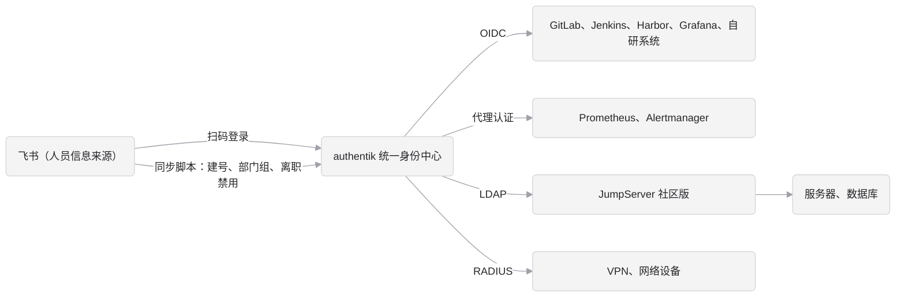

# authentik 生产部署与运维指南

本文说明 authentik 统一身份平台的生产方案：安全加固、权限设计、系统接入、高可用与应急、日常运维和上线检查。适用于 500 到 1000 人、使用飞书作为组织架构来源的场景。

- 部署的具体操作步骤见 [deploy-acs.md](deploy-acs.md)。
- 飞书扫码登录和通讯录同步见 [lark.md](lark.md)。

基于 authentik 2026.8.5 编写。升级到新版本前，先对照官方 [Release Notes](https://docs.goauthentik.io/releases/) 检查本文内容是否仍然适用。

## 0. 文档状态

本文**尚未在真实环境完整走通**。上线前，先在生产环境（正式通知员工之前）按第 3 到第 7 节完整操作一遍，把与实际界面不符的地方改掉，再定稿。

尚待验证的内容：

| 内容 | 状态 | 验证方法 |
|---|---|---|
| authentik 的 “Search full LDAP directory” 权限名 | 未核对 | 和 LDAP provider 的权限设置页面对照 |

飞书扫码登录和同步脚本的待验证项见 [lark.md 第 0 节](lark.md#0-文档状态)。

## 1. 总体架构

authentik 是统一身份中心，飞书是人员信息的唯一来源：

- 员工用飞书扫码登录 authentik。
- 同步脚本每 10 分钟把飞书通讯录同步到 authentik：入职自动建号，部门自动变成用户组，离职或冻结自动禁用。
- 各业务系统按自己支持的协议接入 authentik。



接入方式的选择原则：

| 系统类型 | 接入方式 | 说明 |
|---|---|---|
| 支持 OIDC 或 SAML 的系统 | 单点登录 | 首选。系统拿不到用户密码，统一走 MFA |
| 没有自带登录的页面 | Proxy provider 代理认证 | 如 Prometheus、Alertmanager |
| 只支持 LDAP 的系统 | LDAP outpost | 如 JumpServer。用户需要单独设置 authentik 密码 |
| VPN、网络设备 | RADIUS outpost | 密码认证只支持 PAP |
| 服务器、数据库 | 通过 JumpServer 登录 | 不给个人开服务器账号 |

**authentik 是全公司所有系统的登录入口。** 它一旦不可用，所有人都登录不了任何系统，包括要去修复它的运维人员。第 7 节专门说明高可用和应急通道，上线前必须落实。

## 2. 部署要点

生产环境用 authentik 官方 Helm chart 部署在阿里云 Kubernetes 上，只有生产一个环境，使用专用 namespace。资源规格、部署文件和操作步骤都在 [deploy-acs.md](deploy-acs.md)，这里只说明设计上必须遵守的几点。

**容量**：server 2 核 4 GB × 2、worker 1 核 2 GB × 2、RDS 2 核 4 GB 起，对 1000 人很宽裕。官方最低要求是 2 核 2 GB，当前版本不依赖 Redis。按目录价估算每月约 1300 到 1550 元，最终以公司折扣为准，明细见 [deploy-acs.md 的成本估算](deploy-acs.md#成本估算)。

**多副本**：

- 所有 server 和 worker 使用同一个 `AUTHENTIK_SECRET_KEY`，否则会话和加密数据在副本间不通用。它们读取同一个 Secret。
- 上传的文件存在容器的 `/data` 目录，多副本时只在上传时所在的那个 Pod 上可见。生产环境不挂共享存储，**不在后台上传文件**，图片用 OSS 或 CDN 的 URL。
- server、worker 和 outpost 的版本必须一致。server 和 worker 由 Helm chart 一起发布，outpost 由 authentik 自动升级到相同版本。

**关键配置**（都已写在 `deployments/chart/` 的 values 文件里）：

| 配置项 | 说明 |
|---|---|
| `AUTHENTIK_SECRET_KEY` | 在 Secret 里。泄露后必须更换，而更换会让所有会话失效 |
| `AUTHENTIK_WEB__BASE_URL` | authentik 的访问地址，2026.11 起为必填项 |
| `AUTHENTIK_LISTEN__TRUSTED_PROXY_CIDRS` | 信任哪些地址发来的 `X-Forwarded-For`。设置后会覆盖默认的内网网段，所以要把内网网段一起写上。配错时 authentik 会把负载均衡的地址当作用户 IP，审计日志、GeoIP 策略和登录频率限制都会失效 |
| `AUTHENTIK_ERROR_REPORTING__ENABLED` | `false`，不向外部上报错误信息 |

### 2.1 不要做的事

- 不要给 worker 挂载 Docker socket，也不要给它集群级别的权限。worker 一旦被攻破，攻击者就能控制宿主机或集群。生产环境的 worker 只能操作 IAM 自己的专用 namespace（用来创建和升级 outpost），这个 namespace 里只有 IAM 的资源，所以不会扩大影响范围。这也是 IAM 必须使用专用 namespace 的原因之一。
- 不要使用抢占式实例（`compute-qos-strategy`），实例被回收时全公司都无法登录。
- 不要复用本地验证时生成的密钥，生产环境的密钥要重新生成。
- 不要把 `.env` 或任何密钥提交到仓库。

### 2.2 访问范围：内网还是公网

上线前要决定 authentik 的域名是否开放到公网：

| 方案 | 优点 | 代价 |
|---|---|---|
| 只在内网开放 | 攻击面小 | 员工在外面必须先连 VPN。而 VPN 认证也依赖 authentik，故障时形成死循环，必须有第 7 节的应急通道 |
| 开放到公网 | 员工在任何地方都能登录 SaaS 和对外系统 | 前面要加 WAF 和登录频率限制，并强制 MFA |

不要指望靠封锁 `/if/admin/` 路径来保护管理后台：它只是一个前端页面，所有管理操作都走 `/api/v3/`，而普通员工登录也要用这个接口，没法按路径区分。管理权限靠管理员账号强制 MFA（第 3 节和 5.1 节）和管理员人数控制来保证。开放到公网时，在 WAF 上额外限制 `/api/v3/` 的请求频率。

## 3. 安装后的安全加固

安装完成后马上处理：

1. 给 `akadmin` 开启 MFA，并删除 Secret 里的初始密码，步骤见 [deploy-acs.md 第 4 节](deploy-acs.md#4-首次部署)。
2. 另建一个应急管理员账号，用本地密码加 MFA。用户名不能和任何员工的邮箱前缀相同，否则同步脚本建号时会冲突。
3. 把 `default-authentication-flow` 里的 MFA 校验改为强制配置。这一项只影响用账号密码登录的人（管理员和应急账号），飞书扫码登录不走这一步。
4. 在系统设置里关闭“允许用户修改姓名、邮箱、用户名”，资料统一以飞书为准。不关的话，用户改了也会被同步脚本覆盖。
5. 管理员账号的邮箱和密码要准确记录在公司的密码管理工具里。
6. 配置防止扫码冒用手工账号的策略，并落实飞书账号安全要求，见 [lark.md 3.5 节和 6.1 节](lark.md#35-防止扫码冒用手工账号)。

### 3.1 会话和密码策略

- **会话时长**：在登录流程的 User Login 步骤里明确设置 authentik 的会话有效期，比如 8 到 12 小时，不要依赖默认值。管理员可以单独设得更短。
- **密码策略**：用 JumpServer、VPN 的员工需要单独设置 authentik 密码。给密码修改流程配置密码强度策略（长度、复杂度，可开启泄露密码检查）。
- **LDAP 和 RADIUS 只能做密码认证**：所以 JumpServer 自身的 MFA 必须开启；VPN 需要动态码时按 6.5 节的格式输入。
- **时间同步**：所有 authentik 节点、outpost 和下游系统都要开启 NTP。时间不准会导致 MFA 动态码和 token 校验失败。

### 3.2 管理员账号的使用规则

- `akadmin` 和应急管理员只用于管理和应急，日常不使用。
- 管理员本人日常用飞书扫码登录自己的账号，例如 `charles.shao`。需要管理权限时，把这个账号加入 `authentik Admins` 组。
- 管理员离职时，要同时检查 `authentik Admins` 组和所有服务账号的 token。
- 管理员人数控制在 2 到 3 人，每季度复核一次 `authentik Admins` 组成员。

### 3.3 恢复链接

忘记管理员密码时，生成一次性恢复链接（参数 10 是有效分钟数）：

```bash
kubectl -n iam-passport-prod exec deploy/authentik-worker -- ak create_recovery_key 10 akadmin
```

- 拿到链接的人可以直接以管理员身份登录。用完即弃，不要发到群里。
- 链接只能用一次。用过之后再打开会显示 Not Found，这是正常的。
- 复制时要复制完整。有些工具会把长链接显示成中间带省略号的样子，复制出来的链接就不能用。

## 4. 人员来源接入

authentik 里的员工账号和部门组由同步脚本从通讯录维护，员工通过对应的扫码或单点登录方式登录。

| 来源 | 文档 | 代码 |
|---|---|---|
| 飞书 | [lark.md](lark.md) | `org-sync/feishu/` |

### 4.1 接入其他通讯录来源

通讯录同步按来源分目录存放：

```text
org-sync/
├── feishu/      # 飞书
├── dingtalk/    # 钉钉（规划中）
└── slack/       # Slack（规划中）
```

新增来源时遵守以下约定，避免不同来源的脚本互相干扰：

- **各管各的账号**：每个脚本用自己的标记属性（飞书是 `feishu_managed`，钉钉可用 `dingtalk_managed`），只修改和禁用带自己标记的用户和组。否则飞书脚本会把钉钉来的员工当成离职禁用掉。
- **组名用来源做前缀**：如 `飞书/技术中心`、`钉钉/销售部`，避免同名部门冲突。
- **一个人只属于一个来源**：同一个员工同时出现在两个来源时，第二个脚本会因为用户名已存在而建号失败。接入前先确定每类人员以哪个来源为准，例如正式员工以飞书为准，海外团队以 Slack 为准。
- **用户名规则和登录方式一致**：如果这个来源也提供扫码或单点登录，authentik 里对应 source 的属性映射必须和同步脚本使用相同的用户名规则，参考 [lark.md 3.2 节](lark.md#32-属性映射)。
- **独立部署和监控**：每个来源一个独立的 CronJob（在 `deployments/chart/templates/` 下仿照 `feishu-sync.yaml` 新增）和独立的 Secret，各自配置告警，参考 [lark.md 第 5、6 节](lark.md#5-部署同步脚本)。
- **保留同样的保护机制**：接口报错时在写入前退出，批量禁用超过阈值时中止。

## 5. 权限设计

- **部门组**由同步脚本维护，决定谁能登录哪个应用，在应用的 Bindings 里配置。
- **角色组**手工维护，如 `ops-admin`、`dev-lead`、`monitor-viewer`，配合应用权益（entitlements）决定在应用里的角色。
- 示例：GitLab 只绑定 `飞书/技术中心`；Grafana 全员可以登录，权益 `Grafana Admins` 绑定 `ops-admin`，`Grafana Editors` 绑定 `dev-lead`。

**重要**：应用没有任何绑定时，所有人都能访问。每新建一个应用都要检查绑定，建议把这一项加入应用接入的验收清单。

不要在部门组上手工添加成员，下次同步时会被脚本覆盖。需要例外授权时，用角色组。

角色组成员每季度复核一次，特别是 `ops-admin` 这类高权限组。

### 5.1 高危应用要求二次 MFA

员工扫码登录只依赖飞书账号的安全。对于 JumpServer、生产环境的 Argo CD、各系统的管理后台这类高危应用，要求员工在扫码之后再通过一次 authentik 自己的 MFA（TOTP 或 WebAuthn 安全密钥），即使飞书账号被盗也进不去。

**OIDC、SAML 接入的高危应用**：

1. Flows → Create，新建流程 `mfa-authorization`，Designation 选 Authorization。
2. 给它绑定一个 Authenticator Validation 步骤：
   - Device classes 选 TOTP 和 WebAuthn。
   - Not configured action 选强制用户配置，并选上 TOTP 和 WebAuthn 的配置步骤，让第一次访问的员工当场绑定。
   - Last validation threshold 设为几个小时（如 `hours=8`），避免每次打开应用都要输动态码。
3. 在高危应用的 provider 里，把 Authorization flow 改成 `mfa-authorization`。普通应用继续用默认流程。

**authentik 管理员**：在 `default-source-authentication` 流程里也加一个 Authenticator Validation 步骤（设置同上），这样管理员扫码后还要再过一次 MFA，普通员工不受影响：

1. 绑定顺序（Order）填 `-5`，排在 blueprint 的拒绝步骤（`-10`）之后、User Login（`0`）之前。
2. 绑定上关闭 “Evaluate when flow is planned”，打开 “Re-evaluate policies”。
3. 在这个绑定上加一条 Group 策略，组选 `authentik Admins`。

第 2 步不能省。流程规划时扫码的人还没有确定，按组判断的策略会判为不满足，MFA 步骤被整个跳过，管理员不会收到任何提示。

配好后先在本地 Docker 上验证，上线前再在生产环境用一个普通员工和一个管理员各验证一次。

## 6. 系统接入

按风险从低到高逐个接入，每接一个就验证一个：

1. Grafana（试点，风险最低）
2. GitLab、Jenkins、Harbor、Argo CD
3. Prometheus、Alertmanager
4. JumpServer
5. VPN 和网络设备

每个系统接入时都要做的事：

- 按 6.1 节完成已有账号的比对和迁移方案。
- 在 authentik 里配置绑定，确认只有该用的人能登录。
- 验证角色映射：管理员、普通用户、无权限用户各测一次。
- 关闭系统的本地注册和本地密码登录，只保留一个应急管理员（见第 7 节）。
- 把接入步骤写到 `docs/` 下，方便后续维护。

### 6.1 已有账号的迁移

GitLab、Jenkins 等系统里已经有本地账号。接入单点登录后，如果系统认为新的登录身份和原账号不是同一个人，就会新建一个重复账号，员工原有的项目、权限、历史记录都留在旧账号下。这是推广阶段最容易出事故的环节。

每个系统接入前：

1. 导出系统里现有的全部账号（用户名、邮箱、是否管理员）。
2. 和 authentik 里的账号比对。authentik 的用户名是邮箱前缀，邮箱是飞书里的企业邮箱。
3. 查清这个系统登录时按什么关联老账号：邮箱、用户名，还是 OIDC 的 `sub`。不同系统的行为不同，有的需要单独开启“自动关联已有账号”的配置。
4. 对不上的账号，在系统里先改成和 authentik 一致的用户名或邮箱，再开启单点登录。
5. 找几个不同角色的真实员工先试登录，确认看到的是自己原来的账号和项目。
6. 已离职但系统里还在的账号，借这次机会清理掉。

### 6.2 OIDC 系统

在 [authentik 集成文档目录](https://integrations.goauthentik.io/) 里找对应系统的配置说明，例如 [Grafana](https://integrations.goauthentik.io/monitoring/grafana/)、[GitLab](https://integrations.goauthentik.io/development/gitlab/)。

Grafana 的 scope 加上 `entitlements`，角色映射：

```ini
role_attribute_path = contains(entitlements[*], 'Grafana Admins') && 'Admin' || contains(entitlements[*], 'Grafana Editors') && 'Editor' || 'Viewer'
```

### 6.3 Prometheus、Alertmanager

用 Proxy provider 的 “Forward auth (single application)” 模式，在 Nginx 里加 `auth_request`，参考 [Forward auth 文档](https://docs.goauthentik.io/add-secure-apps/providers/proxy/forward_auth/)。记得把应用加到内置 outpost（embedded outpost）上。

### 6.4 JumpServer（LDAP）

**先评估用 OIDC 接入 JumpServer。** JumpServer 的认证设置里也支持 OIDC（以你们使用的版本为准）。用 OIDC 接入有三个好处：员工直接扫码登录，不用再单独设置 authentik 密码；可以用 5.1 节的二次 MFA；不需要部署和维护 LDAP outpost。只有 JumpServer 的版本或功能确实不支持时，才按下面的步骤走 LDAP。

1. 在 authentik 里准备 LDAP：
   - 建一个专用的 bind flow，只包含识别、密码、登录三个步骤，不带飞书按钮。
   - 建 LDAP provider：Base DN 填 `dc=ldap,dc=company,dc=com`，选择 `ldap.company.com` 的证书，bind flow 选上一步建的流程。
   - 建 LDAP 应用，绑定 `飞书/技术中心`。
   - 建服务账号 `svc-jumpserver`，授予它对该 LDAP provider 的 “Search full LDAP directory” 权限。
2. 部署 outpost，只对内网开放：
   - **生产环境**：在 Applications → Outposts 里新建 LDAP 类型的 outpost，Integration 选 “Local Kubernetes Cluster”，由 authentik 在集群里创建，前面挂内网 NLB。配置见 [deploy-acs.md 第 6 节](deploy-acs.md#6-启用-ldap-outpost)。
   - **本地验证**：Integration 留空（手动部署），保存后点 View Deployment Info 获取 token，再用 `outposts/ldap/` 启动：

     ```bash
     cp outposts/ldap/.env.example outposts/ldap/.env    # 填写 AUTHENTIK_HOST、AUTHENTIK_TOKEN、LDAP_BIND_IP
     make ldap-up
     ```

3. 在 Outposts 页面确认状态为健康，再用 `ldapsearch` 验证：

   ```bash
   ldapsearch -H ldaps://ldap.company.com:636 -x \
     -D 'cn=svc-jumpserver,ou=users,dc=ldap,dc=company,dc=com' -W \
     -b 'ou=users,dc=ldap,dc=company,dc=com' '(cn=charles.shao)'
   ```

4. JumpServer 系统设置 → 认证设置 → LDAP：

   | 项 | 值 |
   |---|---|
   | 地址 | `ldaps://ldap.company.com:636` |
   | 绑定 DN | `cn=svc-jumpserver,ou=users,dc=ldap,dc=company,dc=com` |
   | 用户 OU | `ou=users,dc=ldap,dc=company,dc=com` |
   | 用户过滤器 | `(cn=%(user)s)` |
   | 属性映射 | `{"username": "cn", "name": "name", "email": "mail"}` |

5. JumpServer 里开启强制 MFA，按用户组授权服务器。
6. 保留 JumpServer 的本地管理员账号作为应急通道，见第 7 节。

注意：

- authentik 的 LDAP 只支持认证和查询，不能通过 LDAP 改密码或写入数据。
- 同步脚本建的账号默认没有密码。要用 JumpServer 的人，先在 authentik 个人设置里设置密码。
- 只用 `ldaps://`（636），不要用明文的 389 端口。

### 6.5 VPN 和网络设备（RADIUS）

**先确认 VPN 是否支持 SAML 或 OIDC。** 很多企业级 VPN 支持浏览器跳转式的单点登录，员工可以直接扫码，也能用 5.1 节的二次 MFA。RADIUS 只能用密码认证，动态码要拼在密码后面输入，员工体验差，适合作为网络设备和不支持单点登录的 VPN 的兜底方案。

- 建 RADIUS provider，配置共享密钥和允许的客户端网段。
- 和 LDAP 一样，新建 RADIUS 类型的 outpost，Integration 选 “Local Kubernetes Cluster”，由 authentik 在集群里创建。Service 改成内网 NLB 的方法见 [deploy-acs.md 第 6 节](deploy-acs.md#6-启用-ldap-outpost)，端口是 UDP 1812，NLB 要建 UDP 监听，访问控制只放行 VPN 和网络设备的地址。
- 密码认证只支持 PAP，先确认设备支持。
- 需要动态码时，员工输入 `密码;123456` 格式（密码后加分号和 6 位动态码）。
- VPN 和网络设备都要保留本地应急账号，见第 7 节。
- 参考 [RADIUS 文档](https://docs.goauthentik.io/add-secure-apps/providers/radius/)。

### 6.6 outpost 的通用要求

- 生产环境的 outpost 都由 authentik 在集群里创建，版本随 authentik 自动升级，不要手工部署。
- outpost 的 token 等同于一个高权限凭据。由 authentik 创建的 outpost，token 自动存在 namespace 的 Secret 里，不要导出。
- 创建后在管理后台的 Outposts 页面确认状态为健康。

## 7. 高可用与应急

### 7.1 故障影响

authentik 或它的数据库不可用时：

- 所有员工无法登录任何接入的系统。已经登录的系统，在会话过期前还能继续用。
- VPN 和 JumpServer 也通过 authentik 认证，运维人员连不上 VPN 和服务器，也就无法修复 authentik，形成死循环。

另外，员工只能用飞书扫码登录，所以**飞书故障时新的登录同样会全部失败**，影响和应对见 [lark.md 6.2 节](lark.md#62-飞书故障的影响)。

所以必须同时做到两点：平时尽量不出故障（高可用），出了故障有不依赖 authentik 的应急通道。

### 7.2 恢复目标

上线前和业务方确认两个指标，并按它们决定部署方式：

| 指标 | 含义 | 建议值 | 对应措施 |
|---|---|---|---|
| RTO（恢复时间目标） | 故障后多久必须恢复登录 | 1 小时以内 | server 和 worker 多副本跨可用区，数据库主备自动切换，有恢复操作手册 |
| RPO（数据恢复点目标） | 最多能接受丢失多久的数据 | 1 小时以内 | 云数据库开启时间点恢复（PITR） |

authentik 里的用户和部门组可以由同步脚本从飞书重建，但手工配置的应用、provider、角色组、权益和 MFA 设备无法重建。这部分配置要靠数据库备份，以及 9.5 节的 blueprint。

### 7.3 应急通道

以下应急凭据都不依赖 authentik，放在公司密码管理工具的“应急”保险箱里，只有 CTO 和 1 到 2 名运维负责人能访问：

| 系统 | 应急方式 |
|---|---|
| VPN | 本地应急账号，或一条不经过 authentik 认证的运维专线 |
| JumpServer | 本地管理员账号，开启 MFA |
| 服务器 | 云厂商控制台（VNC 或远程连接），云账号本身开启 MFA |
| authentik | `akadmin` 和应急管理员（本地密码加 MFA），以及服务器上生成恢复链接的权限 |
| 各业务系统 | 每个系统保留一个本地应急管理员 |

要求：

- 应急账号平时禁止使用。每次使用都要记录原因，用完后修改密码。
- 每季度演练一次：假设 authentik 完全不可用，验证运维人员能通过应急通道登录服务器并恢复服务。
- 应急通道的所有登录都要触发告警，防止被滥用。

### 7.4 恢复操作手册

上线前写好并演练以下操作，存放在不依赖 authentik 就能访问的地方（例如打印件，或团队都能访问的离线文档）：

- 单个 Pod 故障：ALB 健康检查自动摘除，Deployment 自动拉起新 Pod。
- 数据库故障：确认云数据库主备切换完成，必要时用时间点恢复。
- 集群或可用区整体故障：在另一个集群用仓库里的 `deployments/`、加密保存的 Secret 内容和 ACR 镜像重新部署（见 deploy-acs.md 第 3、8 节），ALB 指向新集群。
- 流水线不可用（例如 authentik 故障导致登录不了 Jenkins）：用不依赖 authentik 的应急通道直接执行 helm，见 [deploy-acs.md 第 8 节](deploy-acs.md#8-应急发布通道)。
- 误操作（例如误删应用或大量误禁用）：用 RDS 的时间点恢复创建一个临时实例，从中导出所需数据，或整体回滚。

## 8. 登录页品牌定制

推荐只用后台的品牌设置，不自己写登录前端：

- **System → Brands**：logo、标题、favicon、默认背景图、自定义 CSS。
- **Flows → `default-authentication-flow`**：登录页标题（替换 “Welcome to authentik!”）、背景图、布局。
- 素材放在 OSS 或 CDN 上，在这些设置里填 URL。生产环境不在 Customization → Files 上传文件，原因见第 2 节。logo 用 SVG，去掉四周留白，横版宽高比约 7:1。

自定义 CSS 的注意事项：

- 只改 CSS 变量（`--ak-`、`--pf-` 开头）和 `::part()`。直接按标签名或 class 写的样式，升级后很容易失效。
- 每次升级前，在本地 Docker 上用新版本检查登录页和用户门户的显示。
- CSS 写坏导致进不了后台时，用恢复链接登录（会临时禁用自定义 CSS），再去 Brands 里修复。

## 9. 日常运维

### 9.1 备份

- PostgreSQL 每天自动备份，至少保留 30 天，并开启时间点恢复。
- 每季度演练一次恢复：用备份恢复出一个临时 RDS 实例，确认数据完整（用户、应用、绑定都在），演练后删除。
- Secret `iam-passport-authentik` 的内容（尤其是 `AUTHENTIK_SECRET_KEY`）单独加密备份到密码管理工具，和数据库备份分开存放。数据库备份没有对应的 secret key 时，部分加密数据无法恢复。
- 登录页用到的图片在 OSS 上开启版本控制。

### 9.2 升级

- 版本号格式是“年.月”，2026 年起每季度一个版本。只有最近两个版本会收到安全补丁，所以最多落后一个版本。
- 订阅 authentik 的 [GitHub Security Advisories](https://github.com/goauthentik/authentik/security/advisories) 和版本发布通知，有高危漏洞时尽快打补丁。
- 数据库迁移不可逆，回滚只能靠恢复备份。升级前必须备份 RDS。
- 升级后的回归测试至少包括：飞书扫码登录、同步脚本 `--dry-run`、每类接入方式各一个系统（OIDC、代理认证、LDAP、RADIUS）、登录页显示。

操作步骤见 [deploy-acs.md 7.2 节](deploy-acs.md#72-升级-authentik)。

### 9.3 监控和告警

Pod、ALB、RDS、飞书同步的告警规则见 [deploy-acs.md 7.4 节](deploy-acs.md#74-监控和告警)。此外还要关注：

| 监控项 | 方式 |
|---|---|
| 证书 | HTTPS 和 LDAPS 证书到期前 30 天告警 |
| token | 同步脚本和其他服务账号的 token 到期前提醒 |
| 安全事件 | 管理员登录、应急账号登录、批量禁用、权限变更、登录失败次数异常 |

安全事件可以直接用 authentik 发邮件通知：在 Events → Notification Transports 里建一个 Email 类型的通道，再在 Notification Rules 里绑定要通知的事件，接收组选 `ops-admin`。邮件发送的配置见 [deploy-acs.md 3.8 节](deploy-acs.md#38-邮件发送飞书邮箱)。

### 9.4 离职处理

- 正常情况下，由同步脚本在 10 分钟内自动禁用账号并踢掉 authentik 会话。
- 各下游系统里已登录的会话不会马上失效。JumpServer、GitLab 等高危系统要缩短会话有效期。
- 紧急离职（如安全事件）：先在 authentik 里手动禁用，再到 JumpServer、VPN 等高危系统确认会话已断开。
- 离职人员如果有个人 token（如 GitLab Personal Access Token、Harbor 机器人账号），需要在对应系统里单独吊销。authentik 禁用账号不会让这些 token 失效。

### 9.5 配置管理

在后台手工操作出来的配置，没法追溯谁在什么时候改了什么，出了问题也很难恢复。

- 把飞书 source、属性映射、各个应用和 provider、品牌设置逐步写成 blueprint（authentik 的声明式配置文件），放到 `deployments/chart/blueprints/`，随 Helm chart 发布。写法和本地验证方法见 [deploy-acs.md 7.5 节](deploy-acs.md#75-用-blueprints-管理配置)。
- 配置变更走代码评审。
- 暂时还没写成 blueprint 的配置，在后台修改前后要在变更记录里登记。
- 后台的 Events 页面记录了管理员操作，可以用来核对变更。

## 10. 审计与合规

- **日志保存期限**：等保 2.0 和《网络安全法》要求网络日志至少保存 6 个月。authentik 的事件日志在库里有保存期限，到期会自动清理。要把事件日志转发到公司的日志平台（例如通过事件通知规则推送，或定期调用 API 导出），统一保存至少 6 个月。
- **需要保留的日志**：登录成功和失败、管理员操作、账号启用和禁用、权限和组变更、应急账号使用记录。同步脚本的日志也要一起保存。
- **个人信息保护**：authentik 里有员工的姓名、邮箱、部门等个人信息。按《个人信息保护法》的要求，管理员权限只给必要的人，管理员操作要留痕，数据不出境（自建部署，并已关闭错误上报）。
- **定期复核**：每季度复核管理员、高权限角色组、服务账号和 token，记录复核结果。

## 11. 上线组织与决策

### 11.1 技术支持

开源版的功能足够使用，但出了问题只能自己排查或者去社区求助。这套系统决定全公司能不能登录，建议评估 Authentik Security 的企业版订阅，主要买的是技术支持和响应时效，而不是功能。决定不买时，团队里至少要有两个人熟悉 authentik 的部署和排障。

### 11.2 安全测试

authentik 是所有系统的入口。上线前请公司安全团队或外部机构做一次渗透测试，重点包括：登录流程、管理后台的访问控制、对外开放的端口、outpost 的网络隔离。

### 11.3 推广节奏

1. **试点**：在技术中心试点 1 到 2 周，只接入 Grafana 和 GitLab，收集问题。
2. **准备**：写好员工使用说明（怎么扫码登录、怎么设置 JumpServer 密码、怎么设置 MFA），明确出问题找谁、多久响应。
3. **推广**：按部门分批推广，每批之间留出处理问题的时间。
4. **收尾**：所有系统接入后，关闭各系统的本地登录，清理遗留账号。

## 12. 上线检查清单

部署：

- [ ] 正式通知员工之前，已在生产环境按本文和 lark.md 完整走通，两篇文档第 0 节的待验证项已全部确认
- [ ] server 和 worker 各至少 2 个副本，跨可用区，使用同一个 Secret，没有使用抢占式实例
- [ ] 使用云数据库，主备跨可用区，已开启自动备份和时间点恢复，并完成一次恢复演练
- [ ] IAM 使用专用 namespace（最好是独立集群），Jenkins 用 `iam-deployer` 账号发布，Secret 已开启 KMS 加密
- [ ] 只有运维负责人能运行生产发布任务，应急发布通道已演练
- [ ] 后台没有上传文件，图片都用 OSS 或 CDN 的 URL
- [ ] `AUTHENTIK_WEB__BASE_URL` 和 `AUTHENTIK_LISTEN__TRUSTED_PROXY_CIDRS` 已正确配置
- [ ] 镜像从 ACR 拉取，已开启镜像版本不可覆盖
- [ ] 只开放 HTTPS 443，9000、9443 不对公网开放
- [ ] 已决定内网还是公网访问；公网访问时已配置 WAF 和登录频率限制

安全：

- [ ] `akadmin` 已改掉初始密码并开启 MFA，Secret 里的 `AUTHENTIK_BOOTSTRAP_PASSWORD` 已删除，新密码已记录到密码管理工具
- [ ] 已建应急管理员账号，并开启 MFA
- [ ] 密码登录强制 MFA
- [ ] 已设置会话有效期和密码强度策略
- [ ] 已关闭用户修改姓名、邮箱、用户名
- [ ] 所有相关机器已开启 NTP
- [ ] 同步脚本的服务账号只有必要权限，token 过期时间已记录
- [ ] 高危应用和 authentik 管理员已要求二次 MFA，并用一个普通员工和一个管理员实际扫码验证过

高可用与应急：

- [ ] 已和业务方确认 RTO 和 RPO
- [ ] VPN、JumpServer、服务器、各业务系统都有不依赖 authentik 的应急账号，已放入应急保险箱
- [ ] 已完成一次“authentik 完全不可用”的应急演练
- [ ] 恢复操作手册已写好，存放在不依赖 authentik 的地方

人员来源：

- [ ] 已完成 [lark.md 的上线检查清单](lark.md#8-上线检查清单)

系统接入：

- [ ] 每个系统都已完成已有账号的比对，试登录确认关联到原账号
- [ ] 每个应用都配置了绑定
- [ ] JumpServer 和 VPN 已优先评估 OIDC 或 SAML 接入，只在不支持时使用 LDAP 或 RADIUS
- [ ] 每个系统都关闭了本地注册和本地密码登录，只保留应急管理员
- [ ] 高危系统已缩短会话有效期

审计与组织：

- [ ] 事件日志已转发到日志平台，保存至少 6 个月
- [ ] 已完成渗透测试，高危问题已修复
- [ ] 已决定是否购买官方支持；不购买时至少两人掌握运维
- [ ] 员工使用说明和支持渠道已准备好
