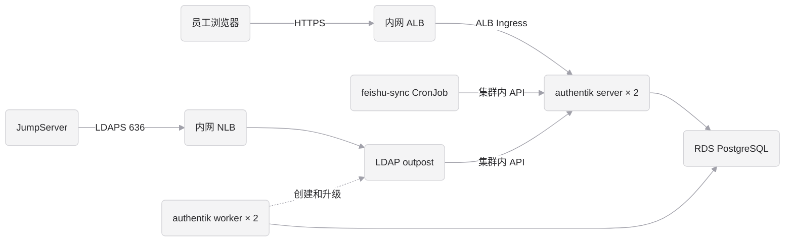

# 在阿里云 Kubernetes 上部署

本文说明如何把 iam-passport 部署到阿里云的 Kubernetes 集群（ACS 或 ACK 都可以）。部署方式：

- 用 **authentik 官方 Helm chart** 部署 authentik，不自己维护 Deployment 文件。
- 仓库里的 `deployments/chart/` 是一个外层 chart，把官方 chart、飞书同步 CronJob 和 blueprints 打包成一个 Helm release。一次 `helm upgrade` 发布全部内容，一次 `helm rollback` 回滚全部内容。
- 只有生产环境，使用**专用 namespace** `iam-passport-prod`，Jenkins 用只能操作这个 namespace 的账号发布。不设测试环境：新配置和新版本先在本地 Docker 上验证。
- LDAP、RADIUS 等 outpost 由 authentik **自己在集群里创建和升级**，版本始终和 authentik 一致。
- Pod 不挂共享存储，全部无状态。

authentik 的安全要求和运维规范见 [authentik.md](authentik.md)，飞书接入见 [feishu.md](feishu.md)。

**搭建顺序**（每一步做完再做下一步）：

| 步骤 | 内容 | 谁来做 |
|---|---|---|
| 1 | 替换仓库里的占位项（3.1 节） | 运维 |
| 2 | 准备集群、namespace 和部署账号（3.2 节） | 集群管理员 |
| 3 | 创建 RDS（3.3 节）、ACR 并同步镜像（3.4 节） | 运维 |
| 4 | 创建 Secret（3.5 节） | 运维 |
| 5 | 域名、证书和 ALB（3.6 节） | 运维 |
| 6 | Jenkins 任务和凭据（3.7 节） | Jenkins 管理员 |
| 7 | 发信邮箱（3.8 节） | 飞书管理员 |
| 8 | 首次部署和安全加固（第 4 节） | 运维 |
| 9 | 飞书扫码登录和通讯录同步（第 5 节） | 运维、飞书管理员 |
| 10 | 监控告警（7.4 节） | 运维 |
| 11 | 按需启用 LDAP outpost（第 6 节） | 运维 |
| 12 | 完成 [authentik.md 的上线检查清单](authentik.md#12-上线检查清单)，再通知员工 | CTO、运维 |

## 0. 文档状态

chart 已经用 `helm lint`、`helm template` 和 Kubernetes 1.31 的 schema 校验过，blueprint 已在本地 authentik 2026.8.5 上应用并验证过策略结果，**但还没有在阿里云集群上实际部署过**。以下内容要在第一次部署后、正式通知员工之前确认：

| 内容 | 验证方法 |
|---|---|
| ALB Ingress 的注解写法、证书自动发现、健康检查 | 部署后 `https://<域名>/` 能打开，ALB 控制台里后端服务器组是 Pod IP 且健康 |
| ALB 的 WebSocket | 管理后台能正常打开，Outposts 页面显示在线 |
| authentik 自动创建的 outpost 在 ACS 上能否启动 | 按第 6 节创建 LDAP outpost 后，namespace 里出现对应的 Deployment，Outposts 页面显示健康 |
| 内网 NLB 的 Service 注解 | LDAP Service 拿到内网地址，`ldapsearch` 能查到用户 |
| Jenkins 构建集群能否访问阿里云 PyPI 镜像 | 跑一次流水线，看 feishu-sync 镜像能否构建成功 |
| 飞书邮箱 SMTP 发信，以及 3.8 节里飞书后台的菜单路径 | `ak test_email` 能收到邮件 |
| `iam-deployer` 的权限是否足够 | 第一次 `helm upgrade --install` 成功，没有 forbidden 报错 |

## 1. 部署架构



namespace `iam-passport-prod` 里有：

| 组件 | Kubernetes 资源 | 规格 | 成本（元/月） | 说明 |
|---|---|---|---|---|
| authentik server | Deployment `authentik-server` | 2 核 4 GB × 2 | 约 520 | 页面和 API。PDB 保证维护时至少留一个副本 |
| authentik worker | Deployment `authentik-worker` | 1 核 2 GB × 2 | 约 260 | 后台任务、应用 blueprints、管理 outpost |
| 入口 | Ingress `authentik-server`（`ingressClassName: alb`） | 内网 ALB 标准版 | 约 110 到 150 | ALB Ingress 控制器把 Pod IP 直接加到 ALB 的服务器组 |
| 飞书同步 | CronJob `feishu-sync` | 0.5 核 1 GB，每 10 分钟一次 | 约 10 | 只在运行期间计费。通过集群内地址调用 authentik API，token 不经过 ALB |
| 配置代码 | ConfigMap `iam-passport-blueprints` | | 0 | `deployments/chart/blueprints/` 下的文件，worker 自动应用 |
| LDAP outpost（可选） | Deployment、Service，由 authentik 创建 | 0.5 核 1 GB × 2，加内网 NLB | 约 130，另加 NLB | 不在 chart 里，见第 6 节 |
| 数据库 | RDS PostgreSQL 高可用系列，主备跨可用区 | 2 核 4 GB，ESSD 云盘 50 GB | 约 400 到 600 | 集群外，开启时间点恢复 |

所有 Pod 都不设置 `compute-qos-strategy`，使用不会被回收的默认实例。authentik 是全公司的登录入口，不能用抢占式实例。

### 成本估算

不含 LDAP outpost 时，每月约 **1300 到 1550 元**。

> 以下是按阿里云官网**目录价**做的估算，用于立项和预算参考。**最终价格以公司与阿里云签订的折扣协议和实际账单为准**，上线前请财务或采购按公司折扣重新核算。

| 组件 | 规格 | 计算方式 | 估算（元/月） |
|---|---|---|---|
| authentik server | 2 核 4 GB × 2 | (2 × 0.0886 + 4 × 0.0443) 元/小时 × 730 小时 × 2 个 | 约 520 |
| authentik worker | 1 核 2 GB × 2 | (1 × 0.0886 + 2 × 0.0443) 元/小时 × 730 小时 × 2 个 | 约 260 |
| 飞书同步 | 0.5 核 1 GB | 只在运行期间计费，每天 144 次，每次约 1 到 2 分钟（含拉取镜像） | 约 10 |
| 内网 ALB | 标准版 | 实例费 0.147 元/小时 × 730 小时，约 107 元；加上按流量计的 LCU 费（0.049 元/个/小时），1000 人的登录流量一般每月几十元以内 | 约 110 到 150 |
| RDS PostgreSQL | 高可用系列 2 核 4 GB，ESSD 云盘 50 GB | 国内地域参考价约 380 元/月，新加坡地域以购买页为准 | 约 400 到 600 |
| **合计** | | | **约 1300 到 1550** |
| LDAP outpost（可选） | 0.5 核 1 GB × 2，加内网 NLB | (0.5 × 0.0886 + 1 × 0.0443) 元/小时 × 730 小时 × 2 个，NLB 另计 | 约 130，另加 NLB |

计算口径：

- **地域**：按新加坡（`ap-southeast-1`，属于“中国香港及海外”价格区）计算。集群放在中国内地时，ACS 单价约低三分之一（vCPU 0.06 元/小时，内存 0.03 元/GiB/小时）。
- **ACS**：通用型、默认算力质量（不使用抢占式）的按量价格，按秒计费。计费规格取容器的 `limits` 之和，规格写在 `values.yaml`。用 ACK 时没有这部分费用，改为按节点规格计算 ECS 费用。
- **时长**：每月按 730 小时计算。
- **价格来源**：阿里云官网的 [ACS 计费规则](https://help.aliyun.com/zh/cs/product-overview/product-billing-rules)、[ALB 计费规则](https://help.aliyun.com/zh/slb/application-load-balancer/alb-billing-rules) 和 RDS 购买页，查询时间为 2026 年 11 月。阿里云会调价，做预算时以当时的价格为准。

降低成本的方式：

- RDS 改为包年包月。海外地域 1 年 7 折、3 年 4.5 折。
- ACS 购买节省计划，抵扣长期运行的 server 和 worker。
- ALB 购买资源包，抵扣实例费和 LCU 费。
- 不要为了省钱把副本数降到 1，或改用抢占式实例。authentik 是全公司的登录入口，高可用的这部分成本必须保留。

表外的共用资源：ACR 企业版实例、NAT 网关（Pod 访问飞书接口和发邮件要用）、SLS 日志、HTTPS 证书。这些通常由多个系统共用，按公司现有资源分摊；单独为 IAM 新建时要另外计入预算。

### 上线后的 Pod

上线后，`iam-passport-prod` 这个 namespace 里常驻 4 个 Pod：2 个 server、2 个 worker。另外每 10 分钟会有一个飞书同步的临时 Pod；启用 LDAP 之后，再多 2 个 outpost Pod。数据库是集群外的 RDS，不占 Pod。

| Pod | 数量 | 类型 | 说明 |
|---|---|---|---|
| `authentik-server-xxxxx` | 2 | 常驻 | 登录页面和 API，ALB 流量打到这里，分布在两个可用区 |
| `authentik-worker-xxxxx` | 2 | 常驻 | 后台任务、应用 blueprints、创建和升级 outpost |
| `feishu-sync-<时间戳>-xxxxx` | 每 10 分钟 1 个 | 临时 | 跑完就结束（状态 Completed），只在运行的一两分钟里计费。第 5 节开启飞书同步之后才会出现 |
| `ak-outpost-<outpost 名称>-xxxxx` | 2 | 常驻，可选 | 按第 6 节启用 LDAP 后，由 authentik 自动创建 |

正常运行时，`kubectl -n iam-passport-prod get pods` 的输出大致是这样（Pod 名后缀是随机的）：

```text
NAME                                   READY   STATUS      RESTARTS   AGE
authentik-server-7d9f8c6b5-2xkqp       1/1     Running     0          3d
authentik-server-7d9f8c6b5-9wzrt       1/1     Running     0          3d
authentik-worker-5c8d7f9b4-hm4vn       1/1     Running     0          3d
authentik-worker-5c8d7f9b4-qp7xs       1/1     Running     0          3d
feishu-sync-29374560-k8f2d             0/1     Completed   0          25m
feishu-sync-29374570-x7m9p             0/1     Completed   0          15m
feishu-sync-29374580-c4n6w             0/1     Completed   0          5m
```

几点说明：

- **飞书同步的 Pod 不会越积越多**。CronJob 最多保留最近 3 次成功和 5 次失败的记录，旧的自动清理。看到 `Error` 状态说明那次同步失败了，用 `kubectl -n iam-passport-prod logs <Pod 名>` 查看原因，这时应该已经触发了告警。
- **发布时会短暂多出一个 Pod**。滚动更新是先起新的、再停旧的，发布过程中 server 会暂时是 3 个。新 Pod 起不来时，旧 Pod 继续提供服务。
- **`RESTARTS` 持续增加**说明容器在反复崩溃，要查看日志：`kubectl -n iam-passport-prod logs <Pod 名> --previous`。
- **不在这个 namespace 里的 Pod**：Jenkins 构建和发布时的 agent Pod 在 Jenkins 的 `ops` namespace 里，构建完就删除；ALB Ingress 控制器是集群级组件，在 `kube-system` 里。

### 为什么不挂共享存储

authentik 只有“在后台上传图片”（logo、背景图、应用图标）会用到 `/data`。多副本时上传的文件必须放在共享存储上，这会引入 NAS、目录权限、快照这些额外的运维工作。

这里的做法是**不在后台上传文件**：

- logo、背景图等放到 OSS 或 CDN，在品牌设置和应用设置里填 URL。
- 登录页的样式用品牌设置里的自定义 CSS，见 [authentik.md 第 8 节](authentik.md#8-登录页品牌定制)。

这样 server 和 worker 完全无状态，Pod 可以随时重建、扩容或迁移。如果后台误上传了文件，文件只会出现在某一个 Pod 上，Pod 重建后就会丢失。

## 2. 仓库里的部署文件

```text
deployments/
├── cluster-setup.yaml            # 集群管理员执行一次：namespace 和部署账号
├── Jenkinsfile                   # 流水线：测试、构建同步镜像、helm 发布
├── feishu-sync.Dockerfile        # 飞书同步镜像
└── chart/                        # 外层 Helm chart
    ├── Chart.yaml                # 依赖的官方 authentik chart 版本
    ├── Chart.lock
    ├── charts/authentik-*.tgz    # 官方 chart 的本地副本，发布时不需要访问外网
    ├── values.yaml               # 通用配置
    ├── values-prod.yaml          # 生产环境特有的配置：域名、数据库地址等
    ├── blueprints/               # authentik 配置代码，见 7.5 节
    └── templates/                # 飞书同步 CronJob、blueprints ConfigMap
Makefile                          # make lint / chart / mirror / image-feishu-sync
```

- 官方 chart 的配置写在 values 文件的 `authentik:` 下面，字段含义见 [官方 chart 的 values.yaml](https://github.com/goauthentik/helm/blob/main/charts/authentik/values.yaml)。
- 密钥都不在仓库里，由 Kubernetes Secret 提供，手工创建一次（见 3.5 节）。
- authentik 和 outpost 的镜像不在流水线里构建，用 `make mirror` 从官方仓库复制到 ACR。
- 本机只需要 Docker：`make lint`、`make chart` 会在容器里运行 helm。

## 3. 首次部署前的准备

### 3.1 上线前需要替换的占位项

仓库里不包含任何公司特定的地址和名称，上线前要全部换成实际值。

**带 `TODO` 的占位项**：没填完时，流水线会在 Checkout 阶段直接失败。

| 位置 | 当前占位 | 替换成 |
|---|---|---|
| `Jenkinsfile` 的 `git_url` | `git@TODO-gitlab-host:TODO-group/iam-passport.git` | 本仓库在公司 GitLab 上的 SSH 地址 |
| `feishu-sync.Dockerfile` 的 `image.source` 标签 | 同上 | 同上（只是镜像标签，不会让流水线失败，但要一起改） |
| `Jenkinsfile` 的 `profiles.prod.credential` | `TODO-iam-passport-prod-kubeconfig` | 3.7 节创建的 kubeconfig 凭据 ID |
| `Jenkinsfile` 的 `feishu_webhook_credential` | `TODO-iam-passport-feishu-webhook` | 构建失败时通知的飞书群机器人，见 3.7 节。不填时流水线照常运行，只是失败时不发通知 |
| `values-prod.yaml` | `TODO-auth.company.com` | authentik 的访问域名（`AUTHENTIK_WEB__BASE_URL`、Ingress 的 `hosts` 和 `tls` 共三处） |
| `values-prod.yaml` | `TODO-prod.pg.rds.aliyuncs.com` | RDS 的连接地址 |
| `values.yaml` | `TODO-noreply@company.com` | 发信邮箱（`AUTHENTIK_EMAIL__USERNAME`、`AUTHENTIK_EMAIL__FROM` 两处），见 3.8 节 |
| `values.yaml`（三处）、`Jenkinsfile`（四处）、`feishu-sync.Dockerfile` | `TODO-registry-vpc` | ACR 实例的 VPC 域名，形如 `<实例名>-registry-vpc.<地域>.cr.aliyuncs.com`，见 3.4 节。`Jenkinsfile` 的 Pod 模板没替换时，agent Pod 拉不到镜像，任务会停在分配 agent，到不了 Checkout |
| `Makefile` 的 `REGISTRY` | `TODO-registry/iam` | ACR 实例的公网域名，形如 `<实例名>-registry.<地域>.cr.aliyuncs.com`，`make mirror` 推送用 |

**已经填了默认名称的项**：流水线不会检查。实际名称不同时，要在仓库里全部替换。

| 名称 | 出现位置 | 说明 |
|---|---|---|
| 拉取镜像的 Secret `aliyun-image-secret` | `values.yaml`、`templates/feishu-sync.yaml`、`Jenkinsfile` | 见 3.2、3.7 节 |
| Jenkins 的 Kubernetes cloud `iam-k8s` | `Jenkinsfile` 的 `agent.kubernetes.cloud` | Jenkins 系统配置里 Kubernetes cloud 的名称。名称不存在时，任务在分配 agent 时就会失败 |
| Jenkins agent 的 namespace `ops` | `Jenkinsfile` 的 Pod 模板 | agent Pod 运行的 namespace |
| Jenkins 工作区 PVC `jenkins-agent-workspace` | `Jenkinsfile` 的 `workspaceVolume` | agent 所在 namespace 里的 PVC |
| ConfigMap `docker-config` | `Jenkinsfile` 的 Pod 模板 | kaniko 推送镜像的凭证，见 3.7 节 |
| Jenkins 凭据 `gitlab-deploy` | `Jenkinsfile` 的 `git` 步骤 | 拉代码用的 SSH 凭据，见 3.7 节 |

替换后用下面的命令检查有没有遗漏的 `TODO`：

```bash
grep -rn 'TODO' deployments Makefile --exclude-dir=charts
```

### 3.2 集群和 namespace

建议 IAM 使用独立的集群。和其他业务共用集群时，至少要做到：

- IAM 使用专用 namespace，其他业务的部署账号不能访问。
- 集群开启 Secret 的 KMS 落盘加密。

集群管理员执行一次：

```bash
sed 's/__namespace__/iam-passport-prod/g' deployments/cluster-setup.yaml | kubectl apply -f -
```

它会创建 namespace 和部署账号 `iam-deployer`。这个账号在自己的 namespace 里可以做任何事，在集群范围只能管理 authentik chart 自带的那一个 ClusterRole（只读的 CRD 列表权限，outpost 控制器需要）。

然后在这个 namespace 里创建拉取镜像用的 Secret `aliyun-image-secret`。用户名和密码是 3.4 节 ACR 实例的访问凭证，建议在 ACR 里单独建一个只读账号：

```bash
read -s ACR_PASS
kubectl -n iam-passport-prod create secret docker-registry aliyun-image-secret \
  --docker-server=TODO-registry-vpc \
  --docker-username='<ACR 只读账号>' --docker-password="$ACR_PASS"
unset ACR_PASS
```

如果集群还没有 ALB Ingress 控制器，先在集群的组件管理里安装，并创建一个指向**内网 ALB** 的 AlbConfig 和对应的 IngressClass `alb`。

确认集群所在的 VPC 有 NAT 网关（或交换机配好了 SNAT）。飞书同步要访问 `open.feishu.cn`，发邮件要访问 `smtp.feishu.cn`，没有公网出口时两者都会超时。

### 3.3 RDS PostgreSQL

1. 创建 RDS PostgreSQL 实例（版本 14 及以上），主备跨可用区，开启时间点恢复。
2. 创建数据库 `authentik` 和同名账号，账号只对这个数据库有权限。
3. 白名单只放集群所在的 VPC 网段。
4. 连接地址填到 `values-prod.yaml` 的 `AUTHENTIK_POSTGRESQL__HOST`。

### 3.4 镜像

1. 在集群所在地域创建一个 ACR 企业版实例。它有两个访问域名：公网域名 `<实例名>-registry.<地域>.cr.aliyuncs.com`（推送用）和 VPC 域名 `<实例名>-registry-vpc.<地域>.cr.aliyuncs.com`（集群拉取用），分别替换仓库里的 `TODO-registry` 和 `TODO-registry-vpc`，见 3.1 节。
2. 在实例里创建两个命名空间：
   - `iam`：authentik、outpost 和飞书同步的镜像，建议开启“镜像版本不可覆盖”。飞书同步镜像每次构建都会生成一个新标签（`prod-<commit>-<构建号>`），给 `iam-passport-feishu-sync` 仓库配置清理规则，保留最近 30 个标签。保留数量不能少于 Helm 保留的 10 个历史版本，否则 `helm rollback` 时旧镜像可能已被删掉。
   - `public`：流水线用的基础镜像和工具镜像。
3. 在 ACR 实例的访问控制里加入 IAM 集群和 Jenkins 所在的 VPC。集群通过 VPC 域名拉取镜像；Jenkins 的 agent 也通过 VPC 域名拉取工具镜像、推送飞书同步镜像。
4. 在 `public` 里准备 kaniko 镜像 `executor:debug`（Jenkins 构建飞书同步镜像用），可以从公司现有 Jenkins 用的同一个镜像同步过来。
5. 在一台能访问 `ghcr.io` 和 Docker Hub 的机器上，登录 ACR 的公网地址，然后复制镜像：

   ```bash
   docker login TODO-registry
   make mirror
   ```

   `make mirror` 会复制 `deployments/chart/Chart.yaml` 里指定版本的 authentik server、LDAP 和 RADIUS outpost 镜像，以及流水线用的 helm 和 python 镜像，所有 CPU 架构都会一起复制。python 镜像同时是飞书同步镜像的基础镜像。

### 3.5 创建 Secret

创建 authentik 用的 Secret。飞书同步的 Secret 要等 authentik 部署好、能创建 API token 之后再建，见第 5 节。

```bash
read -s PG_PASS     # RDS 密码
read -s SMTP_PASS   # 飞书邮箱的第三方客户端密码，见 3.8 节
read -s ADMIN_PASS  # akadmin 的初始密码，先存进密码管理工具
kubectl -n iam-passport-prod create secret generic iam-passport-authentik \
  --from-literal=AUTHENTIK_SECRET_KEY="$(openssl rand -base64 60 | tr -d '\n')" \
  --from-literal=AUTHENTIK_POSTGRESQL__PASSWORD="$PG_PASS" \
  --from-literal=AUTHENTIK_EMAIL__PASSWORD="$SMTP_PASS" \
  --from-literal=AUTHENTIK_BOOTSTRAP_PASSWORD="$ADMIN_PASS" \
  --from-literal=AUTHENTIK_BOOTSTRAP_EMAIL='<管理员邮箱>'
unset PG_PASS SMTP_PASS ADMIN_PASS
```

注意：

- `AUTHENTIK_BOOTSTRAP_*` 只在数据库第一次初始化时用来创建 `akadmin`。akadmin 一开始就有密码，网页上的 initial-setup 页面会直接拒绝访问，不会出现被别人抢先设置管理员的情况。之后再改这两个值不会有任何效果。

- 创建后立即把 `AUTHENTIK_SECRET_KEY` 读出来，加密备份到密码管理工具：`kubectl -n iam-passport-prod get secret iam-passport-authentik -o jsonpath='{.data.AUTHENTIK_SECRET_KEY}' | base64 -d`。数据库备份没有对应的密钥时，部分加密数据无法恢复。
- 修改这个 Secret 后，要重启 server 和 worker 才会生效：`kubectl -n iam-passport-prod rollout restart deployment/authentik-server deployment/authentik-worker`。

### 3.6 域名、证书和 ALB

1. **证书**：把 authentik 域名的 HTTPS 证书上传到阿里云数字证书管理服务。ALB 会按域名自动匹配证书。
2. **ALB Ingress 控制器**：3.2 节已经装好。chart 里已经配置了 HTTPS 443 监听、健康检查路径 `/-/health/ready/`，Pod IP 会直接注册到 ALB 的服务器组，Pod 停止前先等 15 秒让 ALB 摘除它。不需要在控制台手工建服务器组。
3. **在 AlbConfig 或控制台确认**：
   - ALB 是**内网**类型，空闲超时不低于 60 秒。WebSocket 默认支持，不要关掉。
   - 需要员工在公网登录时，再单独建一个公网 ALB 并配 WAF，取舍见 [authentik.md 2.2 节](authentik.md#22-访问范围内网还是公网)。

   ALB 的监听和转发规则由 Ingress 控制器按 chart 生成，在控制台手工改的规则会被控制器覆盖。需要调整时改 `values.yaml` 里 Ingress 的注解。
4. **DNS**：第 4 节首次部署后，ALB 才会创建出来。到时用 `kubectl -n iam-passport-prod get ingress authentik-server` 查到 ALB 的地址，在内网 DNS（如阿里云 PrivateZone）里把 authentik 域名 CNAME 到这个地址。

ALB 的回源地址如果不在 10/8、172.16/12、192.168/16 这些内网网段内，要加到 `values.yaml` 的 `AUTHENTIK_LISTEN__TRUSTED_PROXY_CIDRS`，否则 authentik 记录的用户 IP 都会是 ALB 的地址。

### 3.7 Jenkins 任务和凭据

1. 确认 Jenkins 装了这几个插件：Kubernetes（动态创建 agent Pod）、Pipeline、Credentials Binding（读取 kubeconfig 和 webhook 凭据，一般随 Pipeline 一起安装）。
2. 建一个 Jenkins 任务 `iam-passport-prod`，从 SCM 读取 `deployments/Jenkinsfile`。任务名里必须包含 `prod`，流水线靠它选择环境。
3. 为 3.2 节的部署账号生成 kubeconfig（在能访问集群的机器上，用集群管理员权限执行）：

   ```bash
   NS=iam-passport-prod
   SERVER=$(kubectl config view --minify -o jsonpath='{.clusters[0].cluster.server}')
   kubectl -n $NS get secret iam-deployer-token -o jsonpath='{.data.ca\.crt}' | base64 -d > ca.crt
   TOKEN=$(kubectl -n $NS get secret iam-deployer-token -o jsonpath='{.data.token}' | base64 -d)
   KUBECONFIG=iam-deployer.kubeconfig kubectl config set-cluster iam --server="$SERVER" --certificate-authority=ca.crt --embed-certs=true
   KUBECONFIG=iam-deployer.kubeconfig kubectl config set-credentials iam-deployer --token="$TOKEN"
   KUBECONFIG=iam-deployer.kubeconfig kubectl config set-context iam --cluster=iam --user=iam-deployer --namespace=$NS
   KUBECONFIG=iam-deployer.kubeconfig kubectl config use-context iam
   KUBECONFIG=iam-deployer.kubeconfig kubectl get pods   # 能执行就说明可用
   ```

   `SERVER` 必须是 Jenkins agent 能访问到的地址。Jenkins 和 IAM 不在同一个 VPC 时，要用集群的内网 API Server 地址并打通网络，不要开放公网 API Server。

   在 Jenkins 里把 `iam-deployer.kubeconfig` 上传为 **Secret file** 类型的凭据，ID 填到 Jenkinsfile 的 `profiles.prod.credential`。上传后删除本地的 kubeconfig 和 `ca.crt`。
4. 建一个 SSH 凭据 `gitlab-deploy`，对本仓库有只读权限（在 GitLab 里加一个 Deploy Key）。流水线用它拉代码。
5. Jenkins 的 agent Pod 运行在 Jenkins 所在集群的 `ops` namespace 里，也需要拉取 ACR 镜像和推送飞书同步镜像：
   - 在 `ops` 里创建同名的 `aliyun-image-secret`（方法同 3.2 节），用于拉取 agent 的镜像。
   - kaniko 推送镜像时读取 `ops` 里 ConfigMap `docker-config` 的 `config.json`，里面要有 `TODO-registry-vpc` 的推送凭证。
6. 在运维群里添加一个飞书自定义机器人，把 webhook 地址存成 **Secret text** 类型的凭据，ID 填到 Jenkinsfile 的 `feishu_webhook_credential`。webhook 地址等同于发消息的权限，不要写进仓库。机器人的安全设置选“自定义关键词”，关键词填 `构建失败`；不要开签名校验，流水线没有实现签名。
7. 任务运行后直接发布到生产，没有审批步骤，所以要在 Jenkins 的权限设置里只给运维负责人这个任务的 Build 权限。同一时间只能有一个构建在运行，后触发的会排队；整个构建超过 30 分钟会被中止。

### 3.8 邮件发送（飞书邮箱）

authentik 用邮件发送密码重置链接和安全告警通知。用公司的飞书邮箱发信：

1. **建发信邮箱**：在飞书管理后台建一个公共邮箱账号，比如 `noreply@<公司域名>`，不要用个人邮箱。地址填到 `values.yaml` 的 `AUTHENTIK_EMAIL__USERNAME` 和 `AUTHENTIK_EMAIL__FROM`，两处必须是同一个邮箱，飞书不允许用别的地址发信。
2. **允许第三方客户端**：飞书管理后台 → 邮箱 → 设置里，允许成员使用第三方邮箱客户端（IMAP/SMTP）。
3. **生成客户端密码**：用发信邮箱登录飞书 → 邮箱设置 → 第三方邮箱客户端，生成一个新密码。SMTP 只能用这个密码，不能用飞书登录密码。它在 3.5 节创建 Secret 时写入。以后重新生成密码时，用下面的命令更新：

   ```bash
   read -s SMTP_PASS
   kubectl -n iam-passport-prod patch secret iam-passport-authentik --type merge \
     -p "{\"stringData\":{\"AUTHENTIK_EMAIL__PASSWORD\":\"$SMTP_PASS\"}}"
   unset SMTP_PASS
   kubectl -n iam-passport-prod rollout restart deployment/authentik-server deployment/authentik-worker
   ```

4. **确认网络**：Pod 要能访问公网的 `smtp.feishu.cn:465`。集群所在的 VPC 需要有 NAT 网关，或者给交换机配好 SNAT。
5. **发测试邮件**（第 4 节部署完成后）：

   ```bash
   kubectl -n iam-passport-prod exec deploy/authentik-worker -- ak test_email <你的邮箱>
   ```

   连接超时一般是网络不通；认证失败一般是用了登录密码，或者第 2 步没开。

配置都在 `values.yaml` 的 `authentik.global.env` 里。服务器是 `smtp.feishu.cn`，端口 465，使用 SSL（`USE_SSL=true`，`USE_TLS=false`，两者不能同时开）。

客户端密码在飞书里重新生成后，旧密码立即失效，要同步更新 Secret 并重启。

## 4. 首次部署

1. 运行 `iam-passport-prod` 任务。流水线依次执行：
   - 检查 TODO，以及 `Chart.yaml` 里的 authentik 版本号格式是否正确。
   - 运行 `helm lint`。
   - 构建飞书同步镜像并推送到 ACR。
   - 执行 `helm upgrade --install`，等待 server 和 worker 就绪，最多 15 分钟。第一次启动时 authentik 会初始化数据库，需要几分钟。

   完成后执行 `kubectl -n iam-passport-prod get pods`，应看到 2 个 server 和 2 个 worker 都是 `Running`，对照 [上线后的 Pod](#上线后的-pod)。这时还没有飞书同步的 Pod，第 5 节开启后才会出现。
2. 按 3.6 节第 4 步配置 DNS，确认 `https://<域名>/-/health/ready/` 能访问。
3. 用 `akadmin` 和 3.5 节设置的初始密码登录 `https://<域名>/`，在后台修改密码并开启 MFA。然后从 Secret 里删除初始密码，避免它以明文留在集群里：

   ```bash
   kubectl -n iam-passport-prod patch secret iam-passport-authentik --type json \
     -p '[{"op":"remove","path":"/data/AUTHENTIK_BOOTSTRAP_PASSWORD"}]'
   ```

   删除后不需要重启，这个值只在第一次启动时读取。
4. 按 [authentik.md 第 3 节](authentik.md#3-安装后的安全加固) 做剩下的安全加固。
5. 按 3.8 节第 5 步发一封测试邮件。
6. 在管理后台的 System → Outpost Integrations 里，应能看到一个自动创建的 “Local Kubernetes Cluster”，状态健康。第 6 节创建 outpost 时会用到它。
7. 在 Flows → `default-source-authentication` → Stage Bindings 里，应能看到 blueprint 创建的 `feishu-only-managed-users-deny`；在 `default-authentication-flow` 里，应能看到 `password-login-only-exceptions-deny`（order 15）和 `password-login-require-mfa`（order 31）。

   注意第 3 步：这个 blueprint 应用后，`akadmin` 用密码登录时如果还没绑定 MFA，会被要求当场绑定 TOTP。

每次发布时，`helm template` 渲染出的完整 manifest 会作为构建产物保存在 Jenkins 上，可以用来核对实际发布的内容。

## 5. 启用飞书同步

1. 按 [feishu.md 第 2、3 节](feishu.md#2-创建飞书应用) 配置飞书应用和扫码登录。
2. 按 [feishu.md 5.1 节](feishu.md#51-准备-authentik-服务账号) 创建服务账号和 API token。
3. 创建飞书同步的 Secret：

   ```bash
   read -s FEISHU_APP_SECRET
   read -s AK_TOKEN
   kubectl -n iam-passport-prod create secret generic iam-passport-feishu-sync \
     --from-literal=FEISHU_APP_ID='cli_xxx' \
     --from-literal=FEISHU_APP_SECRET="$FEISHU_APP_SECRET" \
     --from-literal=AK_TOKEN="$AK_TOKEN"
   unset FEISHU_APP_SECRET AK_TOKEN
   ```

4. 把 `values-prod.yaml` 里的 `feishuSync.enabled` 改成 `true`（`dryRun` 保持 `true`），提交后运行流水线。CronJob 开始以试运行模式运行，只打印将要做的变更。
5. 手动触发一次并查看输出：

   ```bash
   kubectl -n iam-passport-prod create job --from=cronjob/feishu-sync feishu-sync-manual-$(date +%s)
   kubectl -n iam-passport-prod logs -f job/<上一条命令创建的 job 名称>
   ```

   按 [feishu.md 5.3 节](feishu.md#53-试运行) 逐条核对输出。
6. 核对无误后，把 `feishuSync.dryRun` 改成 `false`，提交后运行流水线。

## 6. 启用 LDAP outpost

先按 [authentik.md 6.4 节](authentik.md#64-jumpserverldap) 确认 JumpServer 确实需要 LDAP，而不是用 OIDC 接入。

outpost 不写在 chart 里，由 authentik 的 worker 在同一个 namespace 里创建 Deployment 和 Service。authentik 升级时，outpost 会自动升到相同版本。

1. 在 authentik 里创建 LDAP provider 和应用。
2. Applications → Outposts → Create：Type 选 LDAP，Integration 选 “Local Kubernetes Cluster”，选上刚才的应用。
3. 在 Advanced settings 里修改配置：

   ```yaml
   # 集群内直连 authentik，不经过 ALB
   authentik_host: http://authentik-server.iam-passport-prod.svc
   kubernetes_replicas: 2
   kubernetes_image_pull_secrets:
     - aliyun-image-secret
   # 内网 NLB
   kubernetes_service_type: LoadBalancer
   kubernetes_json_patches:
     deployment:
       # 不设规格时，ACS 会按默认的 2 核 4 GB 计费
       - op: add
         path: /spec/template/spec/containers/0/resources
         value:
           requests: { cpu: "0.5", memory: 1Gi }
           limits: { cpu: "0.5", memory: 1Gi }
       - op: add
         path: /spec/template/metadata/labels/alibabacloud.com~1compute-class
         value: general-purpose
       - op: add
         path: /spec/template/metadata/labels/alibabacloud.com~1acs
         value: "true"
     service:
       - op: add
         path: /spec/loadBalancerClass
         value: alibabacloud.com/nlb
       - op: add
         path: /metadata/annotations
         value:
           service.beta.kubernetes.io/alibaba-cloud-loadbalancer-address-type: intranet
           service.beta.kubernetes.io/alibaba-cloud-loadbalancer-zone-maps: "<可用区1>:<交换机1>,<可用区2>:<交换机2>"
   ```

   NLB 的注解以阿里云当前的 CCM 文档为准，第一次配置后按第 0 节验证。不用 ACS 时，去掉两条 `alibabacloud.com` 标签。

4. 保存后几十秒内，namespace 里会出现 `ak-outpost-<名称>` 的 Deployment 和 Service，Outposts 页面显示健康。
5. Service 会同时暴露 389 和 636 端口。在 NLB 的访问控制里只放行 JumpServer 的地址，JumpServer 只配置 `ldaps://<NLB 地址>:636`，配置方法见 authentik.md 6.4 节。

## 7. 日常操作

### 7.1 发布

代码或配置修改合并后，运行对应环境的 Jenkins 任务。副本数、资源规格都以 values 文件为准，手工扩缩容会在下次发布时被覆盖；需要长期调整时改 values 文件。

### 7.2 升级 authentik

1. 阅读新版本的 Release Notes 和官方 chart 的变更说明，备份 RDS。
2. 修改 `deployments/chart/Chart.yaml` 里 authentik 依赖的 `version`。这是仓库里唯一写版本号的地方：官方 chart 的版本号和 authentik 版本号相同，镜像标签默认就取它，`make mirror` 和本地的 `make up` 也从这里读取。
3. 运行 `make chart` 更新 `charts/` 下的本地副本，运行 `make mirror` 复制新镜像，运行 `make lint` 检查。把 `Chart.yaml`、`Chart.lock`、`charts/` 一起提交。
4. 在本地 Docker 上先升级：运行 `make up`（会自动换成新版本），再应用 `deployments/chart/blueprints/` 下的文件（方法见 7.5 节），按 [authentik.md 9.2 节](authentik.md#92-升级) 做回归测试。本地没有真实的飞书和下游系统，这一步主要验证数据库迁移、blueprints、登录页和管理后台。
5. 选业务低峰时段，运行 `iam-passport-prod` 任务。server 和 worker 随发布升级，outpost 随后由 authentik 自动升级。发布后立即验证飞书扫码登录和几个主要系统的单点登录。

没有测试环境，生产升级就是第一次在真实数据上运行新版本的数据库迁移。所以第 1 步的 RDS 备份必须做，而且要确认备份已完成再发布。大版本升级（跨多个版本或 Release Notes 里有破坏性变更）时，可以用 RDS 的克隆实例临时建一个 namespace 演练，演练后删除。

数据库迁移不可逆，出问题时只能用 RDS 备份恢复，不能只把版本号改回去。

### 7.3 回滚

- **发布失败**：`helm upgrade` 没有用 `--atomic`，失败时不会自动回滚，因为新版本可能已经迁移了数据库。server 的滚动策略是 `maxUnavailable: 0`，新 Pod 起不来时旧 Pod 继续提供服务。先查看原因：

  ```bash
  helm -n iam-passport-prod history iam-passport
  kubectl -n iam-passport-prod get pods
  kubectl -n iam-passport-prod logs deploy/authentik-server
  ```

- **发布被中断，release 卡住**：构建在 `helm upgrade` 等待期间被中止（手工中止、超时、agent Pod 被回收）时，release 会停在 `pending-upgrade` 状态，之后每次发布都会报 `another operation (install/upgrade/rollback) is in progress`。先在 Jenkins 上确认没有正在运行的构建，再回滚到最后一个状态为 `deployed` 的版本：

  ```bash
  helm -n iam-passport-prod history iam-passport          # 找到最后一个 deployed 的 REVISION
  helm -n iam-passport-prod rollback iam-passport <REVISION>
  ```

  回滚后重新运行发布任务。如果中断的这次已经升级了 authentik 版本，按下面“authentik 升级后有问题”处理。

- **飞书同步、blueprints 或 values 改错，authentik 版本没变**：回滚到上一个版本，再修复代码：

  ```bash
  helm -n iam-passport-prod rollback iam-passport
  ```

- **authentik 升级后有问题**：见 7.2 节，必须连同数据库一起恢复。

### 7.4 监控和告警

| 监控项 | 告警条件 |
|---|---|
| server、worker 的 Pod 状态 | 可用副本数少于期望值 |
| ALB 健康检查 | 任一后端不健康 |
| authentik 指标 | chart 为 server 和 worker 各建了一个 metrics Service（端口 9300），已带 `prometheus.io/scrape` 注解，Prometheus 按 Service 自动发现即可 |
| 飞书同步 | `time() - kube_cronjob_status_last_successful_time{namespace="iam-passport-prod",cronjob="feishu-sync"} > 1800`，即超过 30 分钟没有成功运行 |
| 飞书同步失败 | `kube_job_status_failed{namespace="iam-passport-prod"}` 增加 |
| outpost | Outposts 页面显示不健康，或 `ak-outpost-*` Deployment 可用副本数少于期望值 |
| RDS | CPU、连接数、存储空间、主备延迟 |

飞书同步和 authentik 的日志建议通过 SLS 采集，保存至少 6 个月。

### 7.5 用 blueprints 管理配置

`deployments/chart/blueprints/` 下的每个 YAML 文件都会进入 ConfigMap，挂载到 worker。worker 启动时以及文件变化后会自动应用。目前有：

| 文件 | 作用 |
|---|---|
| `feishu-only-managed-users.yaml` | 只允许同步脚本建的账号用飞书扫码登录，见 [feishu.md 3.5 节](feishu.md#35-防止扫码冒用手工账号) |
| `password-login-exceptions.yaml` | 员工账号只能扫码，`密码登录例外` 组和手工账号才能用密码登录，且必须过 MFA，见 [authentik.md 第 3 节](authentik.md#3-安装后的安全加固) |

建议逐步把流程、策略、应用和绑定都写成 blueprints，经过代码评审后发布，不在管理后台直接修改。写法参考 [blueprints 文档](https://docs.goauthentik.io/customize/blueprints/)。新的 blueprint 先在本地验证：

```bash
cd authentik
docker compose exec -u root worker mkdir -p /blueprints/local
docker compose cp ../deployments/chart/blueprints/<文件名> worker:/blueprints/local/
docker compose exec worker ak apply_blueprint local/<文件名>
```

## 8. 应急发布通道

Jenkins、GitLab 以后都会接入 authentik 登录。authentik 出故障时，可能登录不了 Jenkins，也就不能通过流水线修复 authentik。所以要准备一条**完全不依赖 authentik** 的通道：

1. 一台堡垒机或运维笔记本，上面装好 helm 和 kubectl，用**阿里云 RAM 账号**获取的 kubeconfig 访问集群，不经过 authentik。
2. 堡垒机上有本仓库的最新代码。
3. 每季度演练一次：在堡垒机上执行 `helm -n iam-passport-prod history iam-passport` 和 `helm -n iam-passport-prod get values iam-passport`，确认能访问集群；回滚命令 `helm rollback` 只在真正需要时执行。

应急发布时执行的命令和流水线相同：

```bash
helm upgrade --install iam-passport deployments/chart \
  --namespace iam-passport-prod \
  -f deployments/chart/values.yaml -f deployments/chart/values-prod.yaml \
  --set feishuSync.image.tag=<当前在用的同步镜像标签> \
  --wait --timeout 15m
```

当前在用的同步镜像标签可以用 `helm -n iam-passport-prod get values iam-passport` 查到。

## 9. 与本地 Docker 部署的对应关系

| 本地（`authentik/compose.yml`） | Kubernetes |
|---|---|
| `postgresql` 容器 | RDS PostgreSQL |
| `./data` 目录 | 不挂载，图片用 OSS 或 CDN 的 URL |
| `.env` 里的密钥 | Secret `iam-passport-authentik` |
| `.env` 里的其他配置 | `values.yaml` 和 `values-prod.yaml` |
| 9000 端口 | ALB Ingress |
| `outposts/ldap/compose.yml` | authentik 自动创建的 outpost 加内网 NLB |
| 虚拟机 cron 加 `flock` | CronJob 加 `concurrencyPolicy: Forbid` |
