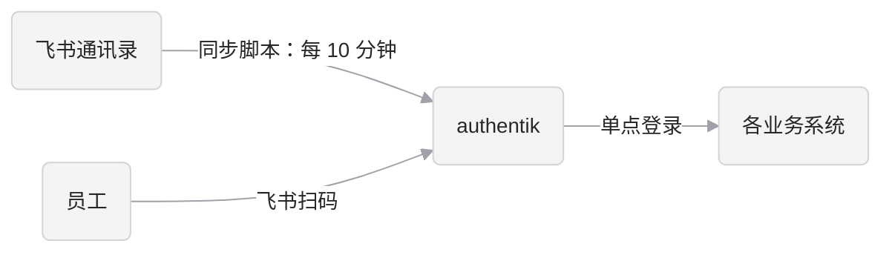

# 飞书接入 authentik

本文说明如何把飞书接入 authentik，实现两件事：

- **扫码登录**：员工用飞书扫码登录 authentik，再通过 authentik 单点登录到各个系统。
- **通讯录同步**：同步脚本每 10 分钟把飞书通讯录同步到 authentik。入职自动建号，部门自动变成用户组，离职或冻结自动禁用。

authentik 本身的部署、安全加固和运维见 [authentik.md](authentik.md)。本文针对飞书中国版（`feishu.cn`）；海外版 Lark 使用 `larksuite.com` 域名，接口地址不同，本文未验证。

## 1. 整体流程



两条链路通过飞书的 **`union_id`** 关联：

1. 同步脚本在 authentik 里建账号，用户名是英文名（“张伟-David” → `david`），并把飞书的 `union_id` 记在账号的 `feishu_union_id` 属性里。
2. 员工第一次扫码时，属性映射按飞书返回的 `union_id` 找到这个账号，authentik 按它的用户名完成绑定。
3. 之后按飞书的 open_id 识别，登录不会改写用户名和资料。

这样设计的好处：

- **用户名只由同步脚本决定**：英文名重复时加的数字（如 `lily2`）、管理员事后改过的用户名，都不影响扫码登录。
- **换飞书应用不用重新绑定**：`union_id` 在同一企业的各个自建应用里都相同。
- **外部人员进不来**：authentik 不允许扫码自动注册，只有同步脚本建过号的人才能登录。

## 2. 创建飞书应用

扫码登录和通讯录同步共用一个企业自建应用，配置需要飞书管理员权限。应用有三项互相独立的设置，缺一项都不行：

| 设置 | 决定什么 | 要求 | 见 |
|---|---|---|---|
| 权限（scope） | 能读哪些字段，比如姓名、邮箱 | 开在“应用身份权限”下 | 2.2 节 |
| 通讯录权限范围（Data access scope） | 能读到哪些人和部门 | 全部成员 | 2.3 节 |
| 可用范围 | 哪些员工能扫码登录 | 全员 | 2.3 节 |

### 2.1 创建应用

在 [飞书开放平台](https://open.feishu.cn/app) 创建企业自建应用，记下 App ID 和 App Secret。

### 2.2 开通权限

位置：开发配置 → 权限管理 → 开通权限（Add permission scopes to app），在 **应用身份权限（Tenant token scopes）** 标签页里搜索权限代码并勾选。同步脚本用应用身份的 token（`tenant_access_token`）读通讯录，开在“用户身份权限（User token scopes）”下不生效。已开通的权限在弹窗里显示为灰色、不能再勾选。

基础权限，同步脚本运行必需：

| 权限 | 界面上的名称 | 用途 |
|---|---|---|
| `contact:department.base:readonly` | Obtain department's basic information | 逐级读取部门，建部门组 |
| `contact:user.base:readonly` | Obtain user's basic information | 读取姓名、英文名、头像和 `union_id` |
| `contact:user.email:readonly` | Obtain user's email information | 同步邮箱。GitLab 等系统要靠邮箱关联老账号、发通知邮件 |

员工资料权限，开通后同步对应的字段（字段说明见 5.5 节）：

| 权限 | 界面上的名称 | 同步的字段 |
|---|---|---|
| `contact:user.employee:readonly` | Obtain user's employment information | 工号、职位、工作城市、工位、入职时间、企业邮箱。还会返回员工状态，冻结的人才会被禁用；不开通时只有离职（从通讯录消失）才禁用 |
| `contact:user.phone:readonly` | Obtain user's mobile number | 手机号 |
| `contact:user.gender:readonly` | Obtain user's gender | 性别 |
| `contact:user.department:readonly` | Obtain user's organization information | 直属上级。这项权限也会返回员工所属部门，但脚本仍按部门逐级查询，不用这个字段 |

字段和权限的对应关系以飞书的 [用户资源介绍](https://open.feishu.cn/document/server-docs/contact-v3/user/field-overview) 为准。扫码登录只用 `union_id`，不需要额外权限。

### 2.3 设置通讯录权限范围和可用范围

1. **通讯录权限范围**：在权限管理页面的权限列表里，点表头“Data access scope”旁边的 **Configure**，Contacts 选 **All members（全部成员）**，保存。也可以由飞书管理员在飞书管理后台 → 工作台 → 应用管理里修改。
2. **可用范围**：发布版本时选全员。不在可用范围内的员工无法扫码登录。

通讯录权限范围默认是“Identical to the availability of app（与应用可用范围一致）”。可用范围只有几个人时，应用也只能读到这几个人，按部门查询会报 40004（no dept authority）。读取根部门要求是全部成员。

### 2.4 重定向 URL 和发布

1. 在“开发配置 → 安全设置 → 重定向 URL”里添加 `https://auth.company.com/source/oauth/callback/feishu/`。末尾的 `feishu` 对应 3.1 节里 source 的 Slug。地址要逐字符一致（包括末尾的 `/`），否则飞书报 20029 错误。
2. 可选：添加“网页应用”能力，主页填 `https://auth.company.com/if/user/`，员工可以在飞书工作台一键打开应用门户。
3. 创建版本并发布。以后修改权限、通讯录范围、可用范围，都要重新发布版本才生效；按企业的设置，发布可能需要管理员审核。

### 2.5 验证配置

发布后跑一次试运行（见 5.3 节），确认：

- 没有 40004 报错，部门组的数量和飞书一致。
- 输出里有更新邮箱的记录（`更新 xxx ['email']`）。全部没有邮箱时，检查邮箱权限是不是开在了用户身份权限下，或者版本没有发布。
- 开通了员工资料权限时，抽查几个人的 attributes 里有职位、手机号等字段。

### 2.6 App Secret 的管理

- App Secret 只保存在 authentik 的飞书 source 和 Secret `iam-passport-feishu-sync` 这两处，不要发到群里或提交到仓库。
- 泄露后立即在飞书开放平台重置，并同时更新这两处。
- 权限和通讯录范围的变更要走变更管理。范围被误改成部分成员时，同步脚本会以为其他人都离职了（脚本有批量禁用保护，见 5.4 节）。

## 3. 配置扫码登录

### 3.1 创建飞书 source

位置：authentik 管理后台 → Directory → Federation and Social login → Create → **OpenID OAuth Source**。

| 字段 | 值 |
|---|---|
| Name | `飞书` |
| Slug | `feishu` |
| Consumer key / secret | 飞书应用的 App ID / App Secret |
| Scopes | `*`（以 `*` 开头表示不附加 authentik 默认的 `openid email profile`，飞书不认这些 scope） |
| Authorization URL | `https://accounts.feishu.cn/open-apis/authen/v1/authorize` |
| Access token URL | `https://open.feishu.cn/open-apis/authen/v2/oauth/token` |
| Profile URL | `https://passport.feishu.cn/suite/passport/oauth/userinfo` |
| Authorization code authentication method | Include the client ID and secret as request parameters |
| User matching mode | 按用户名关联（`username_link`） |
| Enrollment flow | 留空 |
| Authentication flow | `default-source-authentication` |

注意事项：

- **认证方式必须改**：飞书要求 `client_id` 和 `client_secret` 放在请求体里。authentik 默认用 HTTP Basic，两种方式同时用时飞书报 20070 错误。
- **Enrollment flow 必须留空**：这样只有同步脚本建过号的人才能登录。
- 飞书的用户信息地址恰好是 `passport.feishu.cn`，排查日志时注意和本仓库名 `iam-passport` 区分。

### 3.2 属性映射

位置：Customization → Property Mappings → Create → OAuth Source Property Mapping，然后挂到飞书 source 上。

按飞书返回的 `union_id` 找到同步脚本建的账号，返回它原有的用户名、姓名和邮箱，登录时不改写账号资料：

```python
user = ak_user_by(attributes__feishu_union_id=info.get("union_id"), attributes__feishu_managed=True)
if user is None:
    # 没有被同步的人：返回一个不存在的用户名，Enrollment flow 为空，所以登录失败
    return {"username": f"feishu-unsynced-{info.get('union_id')}"}
return {"username": user.username, "name": user.name, "email": user.email}
```

不要在这里按英文名计算用户名：英文名重复时脚本会加数字，按英文名算会登录到别人的账号上。

### 3.3 在登录页显示飞书按钮

Flows → `default-authentication-flow` → Stage Bindings → 编辑识别步骤（identification stage）→ 在 Sources 里加上飞书。保存后登录页就会出现飞书按钮。

识别步骤里的 User fields 清空后，登录页只显示飞书按钮。但管理员和应急账号需要密码登录，建议保留输入框，或另建一个只给管理员用的登录流程。

### 3.4 验证

1. 用一个已被同步脚本建号的员工扫码，应能直接登录并看到应用门户。
2. 在 Directory → Users 里打开这个员工，应能看到他已关联飞书 source。
3. 用一个没有被同步的飞书账号扫码，应登录失败。

### 3.5 防止扫码冒用手工账号

“按用户名关联”有一个隐患：authentik 只看用户名，不看这个账号是不是同步脚本建的。3.2 节的属性映射只返回带 `feishu_managed` 标记的账号，已经避免了扫码登录到 `akadmin`、服务账号等手工账号上。但属性映射被误改（比如改回按英文名计算用户名）时，英文名是 `Akadmin` 的飞书账号就能登录到 `akadmin`。

所以再加一层：在飞书登录的流程（`default-source-authentication`）最前面加一个拒绝步骤，对没有 `feishu_managed` 标记的账号生效：

```python
user = request.context.get("pending_user")
return not (user and user.attributes.get("feishu_managed"))
```

这个配置写在 blueprint `deployments/chart/blueprints/feishu-only-managed-users.yaml` 里，随 Helm chart 发布后由 worker 自动应用，不要在后台手工修改。本地的应用方法见 [deploy-acs.md 7.5 节](deploy-acs.md#75-用-blueprints-管理配置)。应用后，Flows → `default-source-authentication` → Stage Bindings 里排在最前面的是 `feishu-only-managed-users-deny`，它绑定了策略 `feishu-only-managed-users`。

这样 `akadmin`、应急管理员和服务账号都只能用密码登录。验证方法：临时把 3.2 节的属性映射改成直接返回 `{"username": "akadmin"}`，用任意一个已同步的员工扫码，应被拒绝；验证完改回来。

## 4. 本地验证

先在本地 Docker 上验证扫码登录和同步，再上生产。本地 authentik 的启动方法见仓库根目录的 `README.md`。

- **重定向 URL**：在飞书应用里另加 `http://localhost:9000/source/oauth/callback/feishu/`。回调只经过浏览器，飞书服务器不需要能访问你的电脑。
- **扫码登录**：用无痕窗口打开 <http://localhost:9000/>，点登录框下方的飞书图标。登录后在 Directory → Users 里打开自己的账号，应能看到已关联飞书 source。
- **同步**：按 4.1 节在本地运行同步脚本。
- **清理**：本地 authentik 里是真实通讯录的姓名、邮箱、手机号等个人信息，验证完清空重建。同时从飞书应用里删除本地的重定向 URL。

### 4.1 本地运行同步脚本

**准备 API token**：打开 <http://localhost:9000/if/admin/>，进入 Directory → Tokens and App passwords → Create：

| 字段 | 值 |
|---|---|
| Identifier | 如 `feishu-sync-local` |
| User | 本地可以直接用 `akadmin`；生产环境必须按 5.1 节用只有最小权限的服务账号 |
| Intent | API Token |

保存后在列表里点这一行的复制按钮，得到 token。列表里还有一个 `ak-outpost-…-api`，是 authentik 自带 outpost 的 token，只能读不能写，不要复制错。用它运行时，读取都正常，但每个建号都报 `You do not have permission to perform this action.`。

本地也可以不进后台，在 `org-sync` 目录下用一条命令创建（已存在时直接取出）并设置到环境变量里。token 不会显示在屏幕上：

```bash
export AK_TOKEN=$(docker compose -f ../authentik/compose.yml exec -T worker ak shell -c '
from authentik.core.models import Token, TokenIntents, User
t, _ = Token.objects.update_or_create(identifier="feishu-sync-local", defaults={
    "user": User.objects.get(username="akadmin"), "intent": TokenIntents.INTENT_API, "expiring": False})
print("TOKEN=" + t.key)' 2>/dev/null | sed -n 's/^TOKEN=//p')
```

这条命令只用于本地：它直接操作数据库，生产环境要按 5.1 节在后台用服务账号创建。

**安装依赖**：在 `org-sync` 目录下建虚拟环境。建议用和生产镜像相同的 Python 3.13：macOS 自带的 Python 3.9 也能运行，但每次都会打印一条 urllib3 的 `NotOpenSSLWarning`，可以忽略。

```bash
cd org-sync
uv venv --python 3.13 .venv     # 没有 uv 时：python3 -m venv .venv
. .venv/bin/activate
pip install -r requirements.txt  # 用 uv 建的环境：uv pip install -r requirements.txt
```

**设置环境变量**：每开一个新终端都要设置。密钥用 `read -s` 输入，不显示在屏幕上，也不进 shell 历史：

```bash
export FEISHU_APP_ID=cli_xxx AK_URL=http://localhost:9000
read -s FEISHU_APP_SECRET && export FEISHU_APP_SECRET
read -s AK_TOKEN && export AK_TOKEN
curl -s -H "Authorization: Bearer $AK_TOKEN" "$AK_URL/api/v3/core/users/me/" | grep -o '"username":"[^"]*"' | head -1
```

最后一行能打印出用户名，说明 token 可用。

**运行**：

```bash
python3 -m feishu.main --dry-run   # 试运行：只打印将要做的变更
python3 -m feishu.main             # 真正写入
```

脚本要先逐个部门读完整个通讯录，期间没有输出，通讯录大时要等一两分钟。之后每行是一项变更，如 `新建 david`、`更新 lisa ['email']`、`禁用 sam`、`新建组 飞书/技术中心`；失败的项以 `失败` 开头；最后一行是汇总，如 `试运行完成：新建 2，失败 1`。核对要点同 5.3 节。

**检查结果**：

1. 写入后立即再试运行一次，应输出 `试运行完成：没有变更`。还有变更说明某个字段每次都被改写，需要排查。修改脚本后，这是最重要的检查。
2. 在 Directory → Users 里打开几个账号，点 Edit User，在最下面的 Attributes 里核对员工资料（字段见 5.5 节）。账号的 Overview 页面不显示这些属性。
3. 在 Directory → Groups 里核对 `飞书/` 开头的组和飞书的部门结构是否一致。
4. 可选：在飞书里冻结一个测试账号再同步，应输出 `禁用 xxx`；解冻后再同步，账号自动恢复。需要已开通 `contact:user.employee:readonly`。

## 5. 部署同步脚本

脚本在 `org-sync/` 下，只依赖 `requests`。在 `org-sync` 目录下运行 `python3 -m feishu.main [--dry-run]`。

| 文件 | 作用 |
|---|---|
| `feishu/main.py` | 入口和同步规则：建号、更新资料、禁用、部门组 |
| `feishu/contacts.py` | 读取飞书通讯录 |
| `common/authentik.py` | 调用 authentik API，试运行时只打印写入请求。各同步来源共用 |
| `common/retry.py` | 带重试的 HTTP 请求。各同步来源共用 |
| `requirements.txt` | 运行依赖，各同步来源共用 |

### 5.1 准备 authentik 服务账号

1. Directory → Users → Create Service account，例如 `svc-feishu-sync`。
2. 建一个角色并分配给它。角色需要：
   - 用户：查看、新增、修改
   - 组：查看、新增、修改
   - 登录会话（Authenticated Session）：查看、删除
3. 不要把服务账号放进 `authentik Admins` 组。
4. Directory → Tokens → Create，User 选这个服务账号，Intent 选 **API**。创建时注意过期设置，见第 6 节。

### 5.2 部署

生产环境以 Kubernetes CronJob `feishu-sync` 运行，和 authentik 在同一个 Helm release 里，由 Jenkins 流水线构建镜像并发布。脚本通过集群内地址访问 authentik，API token 不经过 ALB。部署文件是 `deployments/chart/templates/feishu-sync.yaml` 和 `deployments/feishu-sync.Dockerfile`。创建 Secret、开启 CronJob、手动触发试运行的命令见 [deploy-acs.md 第 5 节](deploy-acs.md#5-启用飞书同步)。

| CronJob 设置 | 值 | 作用 |
|---|---|---|
| `schedule` | `*/10 * * * *` | 每 10 分钟运行一次 |
| `concurrencyPolicy` | `Forbid` | 上一次没跑完时不启动新的一次，防止两次同时写入 |
| `activeDeadlineSeconds` | 540 | 单次运行超过 9 分钟就终止，不影响下一次 |
| `backoffLimit` | 0 | 失败不重试，等下一次定时运行 |

日志通过 SLS 采集，保存至少 6 个月。告警规则见 [deploy-acs.md 7.4 节](deploy-acs.md#74-监控和告警)。

### 5.3 试运行

新开启的 CronJob 默认带 `--dry-run` 参数，只打印将要做的变更，不写入任何数据。第一次运行时逐条核对：

- **用户名**：是否都是员工的英文名。重名的人用户名带数字（如 `lily2`），可以在 authentik 里改成更好认的名字（如 `lily.wang`），脚本不会改回去。
- **部门组**：层级和名称是否和飞书一致。
- **没有英文名的员工**：请他们在飞书里填写英文名，或把姓名改成“中文名-英文名”。
- **邮箱**：没有邮箱或域名拼错的，请飞书管理员在飞书里改正，下次同步自动更新。
- **待禁用名单**：是否合理。

核对无误后再关闭试运行。本地也可以直接运行脚本，方法见 4.1 节。

### 5.4 脚本的行为

| 场景 | 脚本的处理 |
|---|---|
| 新员工 | 新建账号，默认没有密码。用户名是英文名转小写、空格换成点：优先用飞书的英文名字段；没填时取姓名里 `-` 后面的部分（“张伟-David” → `david`）；姓名是纯英文时直接用（“John Smith” → `john.smith`） |
| 英文名重复 | 依次加数字，如 `lily`、`lily2`、`lily3`，部门层级靠上的人先分配。和手工账号重名时也加数字（`akadmin2`），不占用手工账号 |
| 没有英文名 | 不建号，报错提示在飞书里补英文名。其余人照常处理，最后以非 0 退出 |
| 资料变化 | 姓名、邮箱、头像和员工资料按 5.5 节更新。用户名只在建号时分配，之后不变 |
| 部门 | 每个部门对应一个组，如 `飞书/技术中心/运维组`。上级部门的组包含所有下级部门的人。部门改名时组名跟着改 |
| 部门删除 | 清空组成员，但不删除组，组上的应用绑定保留。之后又建了同名部门时沿用这个组，原来的应用绑定继续生效；别的部门改成了这个名字时，旧组改名为 `…（已删除）`，把名字让出来 |
| 离职（从通讯录消失） | 禁用账号，并踢掉 authentik 里的登录会话。账号和资料保留，见 5.5 节 |
| 冻结 | 开通了 `contact:user.employee:readonly` 时同离职；没开通时拿不到员工状态，不会禁用 |
| 重新出现在通讯录里（如解冻） | 自动恢复。只恢复被脚本禁用的账号，管理员手动禁用的不恢复 |
| 离职后重新入职 | 飞书通常会分配新的 `union_id`，脚本当作新人建号（用户名可能带数字，如 `david2`），旧账号保持禁用，新人不继承旧账号在各系统里的数据。确实要沿用旧账号时，把旧账号 attributes 里的 `feishu_union_id` 改成新值，再删除新账号，下次同步自动恢复旧账号 |
| 飞书接口偶发错误（断连、限流、5xx、40003 内部错误） | 自动重试，最多 3 次 |
| 飞书接口持续报错 | 在写入任何数据前退出 |
| 某一项写入 authentik 失败 | 记录下来，继续处理其他人和组，最后以非 0 退出，触发告警。authentik 偶发错误时修改和查询会重试；新建不重试（服务端可能已经建好，重试会重复建），下次同步自动补上 |
| 一次要禁用超过 5 个且超过在职账号 10% 的账号 | 直接中止，防止通讯录范围被误改后把全员禁用。处理方法见第 7 节 |

脚本只处理带 `feishu_managed` 标记的用户和组，不会动手工创建的账号（如 `akadmin`、服务账号）和手工维护的角色组。

每次运行结束时打印一行汇总，如 `同步完成：新建 2，更新 5，禁用 1` 或 `同步完成：没有变更`，从日志里能确认每次都运行过。

直接挂在根部门下的员工不属于任何部门组。要把应用开放给所有员工，不要绑定部门组，在应用上绑定一个表达式策略：

```python
return request.user.attributes.get("feishu_managed", False)
```

离职最多有 10 分钟的延迟。紧急情况直接在 authentik 里手动禁用。需要秒级生效时，可以订阅飞书的员工离职事件 `contact.user.deleted_v3` 来触发脚本。

### 5.5 同步的字段

| authentik 字段 | 飞书字段 | 需要的权限 | 说明 |
|---|---|---|---|
| `username` | `en_name`、`name` | `contact:user.base:readonly` | 只在建号时分配，规则见 5.4 节 |
| `name` | `name` | `contact:user.base:readonly` | 去掉首尾空格 |
| `email` | `email`，为空时用 `enterprise_email` | `contact:user.email:readonly`；企业邮箱要 `contact:user.employee:readonly` | 转小写 |
| `attributes.feishu_union_id` | `union_id` | `contact:user.base:readonly` | 账号和飞书的关联，不要手工修改 |
| `attributes.avatar` | `avatar.avatar_240` | `contact:user.base:readonly` | 240 像素头像的地址。需要 authentik 的头像设置读这个属性，见 [authentik.md 第 3 节](authentik.md#3-安装后的安全加固) |
| `attributes.employee_no` | `employee_no` | `contact:user.employee:readonly` | 工号 |
| `attributes.job_title` | `job_title` | `contact:user.employee:readonly` | 职位 |
| `attributes.work_city` | `city` | `contact:user.employee:readonly` | 工作城市 |
| `attributes.work_station` | `work_station` | `contact:user.employee:readonly` | 工位 |
| `attributes.join_date` | `join_time` | `contact:user.employee:readonly` | 入职日期，按北京时间换算，如 `2023-11-15` |
| `attributes.mobile` | `mobile` | `contact:user.phone:readonly` | 手机号，带国家码，如 `+86138…` |
| `attributes.gender` | `gender` | `contact:user.gender:readonly` | `male`、`female`、`other`；飞书里是“未知”时不写 |
| `attributes.leader` | `leader_user_id` | `contact:user.department:readonly` | 直属上级在 authentik 里的用户名；上级没有账号（如没有英文名）时不写 |

更新规则：

- **飞书里清空的字段**：authentik 里也删掉。
- **飞书没返回的字段**（没开通权限，或权限被关掉）：保留 authentik 里的原值，不会因为权限变动清空全员的数据。
- 脚本还会写 `attributes.feishu_managed`（同步账号的标记）和 `attributes.feishu_deactivated`（被脚本禁用的标记），不要手工修改。

这些字段默认只存在 authentik 里。接入的系统要用时，在 authentik 的 OIDC 或 LDAP 属性映射里按需暴露；手机号等敏感信息只给确实需要的系统，见第 6 节。

**离职人员的数据**：账号只禁用、不删除，用户名、姓名、邮箱和以上员工资料都保留，离职后不再更新。这样做是为了：

- 审计时能查到离职人员是谁、在哪个部门、上级是谁，authentik 的登录和操作日志也能对应到人。
- 用户名不被新同事占用，重名的新人会加数字，下游系统里离职人员的数据不会被新人继承。
- 重新入职时可以按 5.4 节恢复旧账号。

保留的数据包含手机号等个人信息，所以 authentik 管理员权限要严格控制。公司有数据保留期限要求时，到期后由管理员在 authentik 里删除账号；删除后这个用户名可以重新分配给新人。

## 6. 风险和对策

| 风险 | 后果 | 对策 |
|---|---|---|
| authentik API token 过期 | 脚本持续报错，入职不建号、离职不禁用，可能长时间没人发现 | 创建 token 时确认过期设置。不过期时每半年手动轮换一次并设日历提醒；设了过期时间时在到期前轮换 |
| 同步长时间没有成功运行 | 入职不建号、离职不禁用，没有任何报错 | 监控 CronJob 最近一次成功的时间，超过 30 分钟就告警 |
| 脚本出错或部分写入失败 | 新员工没建号，或离职员工没被禁用 | 脚本以非 0 退出码结束并列出每一项失败；CronJob 失败时告警，比如发到飞书群机器人 |
| 两次运行重叠 | 两个进程同时写入，可能互相覆盖组成员 | CronJob 设置 `concurrencyPolicy: Forbid`，见 5.2 节 |
| 飞书通讯录范围被误改 | 脚本以为大量员工离职 | 脚本有批量禁用保护；范围变更纳入变更管理 |
| 英文名重复 | 用户名带数字（如 `lily2`），员工在 JumpServer、VPN 等要输入用户名的地方不知道自己的用户名 | 试运行后把带数字的用户名告知本人，或在 authentik 里改成更好认的名字（如 `lily.wang`）。改用户名不影响扫码登录和同步 |
| 离职员工的英文名被新同事使用 | 新同事的用户名带数字，旧账号保持禁用，不会被新人继承 | 无需处理。确实是同一个人重新入职时，按 5.4 节改绑旧账号 |
| 用户名和手工账号重名 | 脚本给员工加数字（`akadmin2`），不会占用手工账号；扫码登录只会找到同步脚本建的账号 | 手工账号不要用可能和员工重名的用户名，并配置 3.5 节的防冒用策略作为第二层保护 |
| 用户名不对应企业邮箱 | LDAP、OIDC 接入的系统拿到的用户名是英文名，不是邮箱前缀，按用户名关联不上老账号 | 接入时让系统按邮箱关联老账号 |
| 员工在飞书里没填邮箱 | 依赖邮箱的系统（如 GitLab）会让他自己补填，补填的邮箱没有校验 | 接入这类系统前，在 authentik 里查出邮箱为空的同步账号，请飞书管理员补上 |
| 手机号等个人信息扩散 | authentik 管理员能看到全员的手机号、性别、入职时间等；放进 OIDC 或 LDAP 后，接入的系统也能拿到 | 管理员权限只给必要的人；手机号默认不放进任何 OIDC scope 和 LDAP 属性，确实需要的系统单独评估、单独配置 |
| 用户在 authentik 里修改了姓名 | 下次同步时被覆盖 | 在 authentik 系统设置里关闭用户修改姓名、邮箱、用户名 |

### 6.1 飞书账号安全

员工扫码后就能进入所有接入的系统，所以**飞书账号的安全等于整个平台的安全**。飞书账号被盗，攻击者就能以这个员工的身份登录 GitLab、Grafana 等系统。

- **强制二次验证**：在飞书管理后台对全员开启登录二次验证，并开启新设备登录提醒。
- **控制飞书管理员**：飞书管理员可以修改员工的姓名、创建新账号，间接决定新账号在 authentik 里的用户名。飞书管理员人数要少，操作要有审计。
- **高危系统再加一层 MFA**：JumpServer、authentik 管理后台等高危系统，要求员工扫码之后再通过 authentik 自己的 MFA，配置方法见 [authentik.md 5.1 节](authentik.md#51-高危应用要求二次-mfa)。

### 6.2 飞书故障的影响

员工只能用飞书扫码登录，所以飞书开放平台或飞书登录故障时：

- 已经登录的系统，在会话过期前不受影响。
- 新的登录全部失败，包括会话过期后需要重新登录的人。
- 通讯录同步报错退出，不会误禁用任何人。

应对方式：

- authentik 的会话有效期按工作日设置（如 8 到 12 小时），避免故障期间大量会话同时过期。
- 管理员和应急账号用本地密码加 MFA 登录，不受飞书故障影响，见 [authentik.md 7.3 节](authentik.md#73-应急通道)。
- 关键岗位需要在飞书故障时也能登录的，提前把这些人加进 `密码登录例外` 组，让他们设置 authentik 密码并绑定 MFA，并在登录页保留用户名密码输入框。

## 7. 常见问题

**扫码后报 20029 错误**

重定向 URL 和飞书应用里配置的不一致，常见的是少了末尾的 `/`，或者 source 的 Slug 不是 `feishu`。见 2.4 节。

**扫码后报 20070 错误**

Authorization code authentication method 没有改成 “Include the client ID and secret as request parameters”。见 3.1 节。

**扫码后提示登录失败，或者跳到了注册页面**

- 这个员工还没有被同步脚本建号：检查他是否有英文名、是否在飞书应用的可用范围内，以及同步脚本最近是否成功运行。
- 找不到账号：在 Directory → Users 里搜索这个员工，确认账号 attributes 里的 `feishu_union_id` 有值，且带 `feishu_managed` 标记。
- 属性映射没有挂到飞书 source 上，或者规则和同步脚本不一致。见 3.2 节。

**员工能登录 authentik，但看不到某个应用**

应用的绑定里没有包含他所在的部门组或角色组。部门组由同步脚本维护，不要手工往部门组里加人；需要例外授权时用角色组。见 [authentik.md 第 5 节](authentik.md#5-权限设计)。

**员工用 JumpServer、VPN 时提示密码错误**

同步脚本建的账号默认没有密码。员工要先扫码登录 authentik，在个人设置里设置密码。这个密码只能用于 JumpServer、VPN；在 authentik 登录页用密码登录会被拒绝，除非在 `密码登录例外` 组里，见 [authentik.md 第 3 节](authentik.md#3-安装后的安全加固)。

**同步脚本报 40004（no dept authority error）**

通讯录权限范围不是全部成员，常见的是还停在默认的“与应用可用范围一致”。按 2.3 节改成全部成员，再发布版本。

**同步脚本报 40003（Internal Error）**

飞书接口的临时错误，脚本会自动重试 3 次。3 次都失败时，脚本在写入任何数据前退出，下一次运行通常会恢复。频繁出现时查看飞书开放平台的状态，或用报错里的 `log_id` 联系飞书技术支持。

**同步脚本每一项都报 `You do not have permission to perform this action.`**

`AK_TOKEN` 所属的账号没有写权限。先确认 token 是谁的：

```bash
curl -s -H "Authorization: Bearer $AK_TOKEN" "$AK_URL/api/v3/core/users/me/" | grep -o '"username":"[^"]*"' | head -1
```

本地常见的是误用了 outpost 的 token（用户名是 `ak-outpost-…`），按 4.1 节换一个。生产环境是服务账号缺少 5.1 节列出的权限。

**同步后账号都没有邮箱，或者没有职位、手机号**

对应的权限没有开在应用身份权限下，或者开通后没有发布版本，见 2.2 节。只有个别人没有，是飞书里本来就没填。

**同步脚本报“本次要禁用 N 个账号，超过阈值，已中止”**

先确认飞书应用的通讯录权限范围有没有被改动。确实是批量离职或组织调整时：

1. 手动跑一次试运行，核对日志里“禁用”开头的名单：

   ```bash
   kubectl -n iam-passport-prod create job --from=cronjob/feishu-sync feishu-sync-check-$(date +%s) --dry-run=client -o yaml \
     | yq '.spec.template.spec.containers[0].args = ["--dry-run", "--max-disable", "N"]' | kubectl apply -f -
   ```

   命令里的 `yq` 要求 v4 版本。

2. 名单无误后，把 `args` 换成 `["--max-disable", "N"]` 再运行一次。`N` 是报错信息里的人数，只对这一次运行生效，定时任务仍按默认阈值。

默认阈值是 `org-sync/feishu/main.py` 里的 `DISABLE_GUARD_MIN` 和 `DISABLE_GUARD_RATIO`，按在职账号计算，已禁用的账号不计入。

## 8. 上线检查清单

飞书应用：

- [ ] 已在应用身份权限下开通 2.2 节的权限
- [ ] 通讯录权限范围是全部成员，可用范围是全员
- [ ] 生产重定向 URL 已添加，本地验证用的 localhost 重定向 URL 已删除，版本已发布
- [ ] 飞书已对全员开启登录二次验证，飞书管理员名单已复核

扫码登录：

- [ ] 飞书 source 的认证方式已改为请求参数，Enrollment flow 为空
- [ ] 属性映射按 `union_id` 查找账号（3.2 节），没有按英文名计算用户名
- [ ] 已配置 3.5 节的防冒用策略，并用测试账号验证手工账号无法通过扫码登录
- [ ] 已用三类账号验证扫码登录：已同步的员工、未同步的账号、已离职的员工
- [ ] 已关闭用户在 authentik 里修改姓名、邮箱、用户名

同步脚本：

- [ ] 服务账号只有必要权限，token 过期时间已记录
- [ ] `--dry-run` 输出已人工核对：用户名、部门组、待禁用名单
- [ ] 带数字的用户名已告知本人或已改名，没有英文名、没有邮箱的员工已在飞书里补上
- [ ] 手工账号（`akadmin`、应急管理员、服务账号）的用户名不会和员工重名
- [ ] CronJob 已关闭试运行模式，运行失败和“30 分钟未成功”的告警已配置并测试
