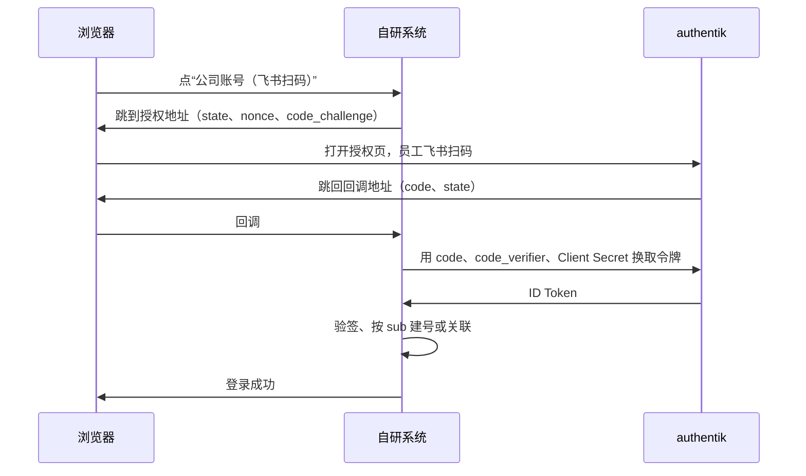

# 自研系统接入

本文给公司自研系统的开发者使用，说明系统怎么接入公司统一身份平台（authentik）：接入前要申请什么、用到的地址和员工信息、登录的实现、角色、退出、离职处理、联调自测和常见问题。

接入后，系统自己不保存任何密码，员工用公司账号登录：

- **公司账号（飞书扫码）**：浏览器跳到 authentik 扫码后回到系统，基于标准的 OIDC 协议。所有自研系统都用这种方式。
- **账号密码**（可选）：登录页保留账号密码框，系统服务端把账号密码交给 authentik 校验。只在确实需要时增加，见第 7 节。

文中的 `auth.company.com`、`app.company.com` 都是占位地址，`<slug>` 是 IAM 管理员给系统分配的应用标识，出现在 authentik 的地址里。authentik 那边的配置都由 IAM 管理员完成，文中需要找 IAM 管理员的地方都已注明。

## 快速接入

大部分系统用现成的 OIDC 库接入，按下面几步做即可：

1. 向 IAM 管理员申请接入，拿到 Issuer、Client ID、Client Secret 和权益名称，见第 1 节。
2. 在 OIDC 库里配置 Issuer、Client ID、Client Secret 和回调地址，scope 填 `openid profile email entitlements`，用授权码模式加 PKCE。库会从 Issuer 自动发现其他地址，并完成 ID Token 的校验。
3. 登录成功后，按 ID Token 里的 `sub` 建号或关联本地账号，见第 2 节。
4. 按 ID Token 里的 `entitlements` 判断员工在系统里的角色，见第 4 节。
5. 提供退出。需要同时注销公司账号时，跳到退出登录地址并带上 `id_token_hint`，见第 5 节。
6. 会话设置有效期，系统里能停用离职员工的账号，见第 6 节。

第 3 节逐步说明协议细节，没有现成的库或者排查问题时再看。第 7 节的账号密码登录只在确实需要时实现。

## 1. 接入前准备

向 IAM 管理员提出接入申请，提供：

| 项 | 说明 | 示例 |
|---|---|---|
| 系统名称和标识 | 标识用于地址，小写字母和连字符 | 订单后台，`order-admin` |
| 回调地址 | 系统接收授权码的地址，必须是完整的 HTTPS 地址 | `https://app.company.com/auth/callback` |
| 退出后跳转地址 | 员工注销公司账号后回到的页面，一般是系统的登录页 | `https://app.company.com/login` |
| 谁能登录 | 写部门或人员范围即可，对应的组名由 IAM 管理员确认 | 技术中心全体 |
| 系统里的角色 | 需要按公司账号自动区分的角色 | 管理员 |
| 是否需要账号密码登录 | 需要时说明原因，见第 7 节 | 否 |
| 本机开发用的地址 | 在自己电脑上联调时的回调地址和退出后跳转地址，见第 8 节 | `http://localhost:8080/auth/callback` |

IAM 管理员配置好后会给你：

- **Issuer**：`https://auth.company.com/application/o/<slug>/`
- **Client ID** 和 **Client Secret**：Client Secret 等同于系统的密码，放在配置中心或密钥管理里，不要提交到代码仓库，不要写进前端代码。
- **权益名称**：如 `Order Admin Admins`。权益（entitlement）是 authentik 里按应用定义的角色标识，绑定到组后，组里的员工登录这个系统时 ID Token 里就带上它，系统据此区分角色，见第 4 节。
- **开发用的应用**：一套单独的 Issuer、Client ID 和 Client Secret，回调地址是本机地址，只给开发人员用，见第 8 节。

另外确认系统的**服务器**能解析和访问 `auth.company.com`。浏览器能打开不代表服务器能访问，换取令牌、取公钥都是服务器发起的。

## 2. 地址和员工信息

系统支持自动发现时，只配置 Issuer，其他地址从 `<Issuer>.well-known/openid-configuration` 读取：

| 用途 | 地址 | 谁访问 |
|---|---|---|
| Issuer | `https://auth.company.com/application/o/<slug>/` | 不直接访问，用来校验 ID Token 的 `iss` |
| 自动发现 | `https://auth.company.com/application/o/<slug>/.well-known/openid-configuration` | 服务器 |
| 授权 | `https://auth.company.com/application/o/authorize/` | 浏览器 |
| 换取令牌 | `https://auth.company.com/application/o/token/` | 服务器 |
| 用户信息 | `https://auth.company.com/application/o/userinfo/` | 服务器。ID Token 已包含下表的字段，一般不用调用 |
| 公钥（JWKS） | `https://auth.company.com/application/o/<slug>/jwks/` | 服务器 |
| 退出登录 | `https://auth.company.com/application/o/<slug>/end-session/` | 浏览器 |

ID Token 里的员工信息：

| 字段 | 含义 | 示例 |
|---|---|---|
| `sub` | 员工在本系统的唯一标识，**关联账号只用它** | `8fc0041f7b08…` |
| `preferred_username` | 用户名 | `david` |
| `name` | 姓名 | `张伟-David` |
| `email` | 邮箱，可能为空 | `david@company.com` |
| `groups` | 所在的全部组，包括部门组 | `["飞书/技术中心"]` |
| `entitlements` | 员工在本系统上的权益 | `["Order Admin Admins"]` |

注意：

- 用户名和邮箱会变（管理员改名、飞书里改邮箱），不要用来关联账号。`sub` 不随它们变化。
- `sub` 按 authentik 账号生成，同一个员工在所有系统里的 `sub` 相同。它只是标识，不要展示给员工或当作工号使用。
- 手机号、工号等默认不提供。确实需要时向 IAM 管理员申请，说明用途。

**老系统已有本地账号时**，员工第一次用公司账号登录，系统按 `sub` 找不到账号，会当成新人建一个重复账号，原来的数据和权限都留在旧账号下。上线前要做一次关联：

1. 导出系统里现有的账号，和 IAM 管理员核对 authentik 里的用户名和邮箱。authentik 的用户名是员工的英文名（重名时带数字，如 `lily2`），邮箱取自飞书。老账号一般是邮箱前缀，优先按邮箱对。
2. 对不上的账号，先在系统里改成和 authentik 一致的邮箱。
3. 员工第一次登录时，按 `sub` 找不到账号的，再按邮箱找一次没有关联过 `sub` 的老账号，找到就把 `sub` 写进去。以后只按 `sub` 关联。
4. 找几个不同角色的员工先试登录，确认看到的是自己原来的账号和数据。

## 3. 公司账号（飞书扫码）登录

流程是 OIDC 授权码模式加 PKCE。其中三个随机值的作用：

- `state`：回调时核对，防止别人伪造回调，把自己的账号登录到员工的浏览器里。
- `nonce`：写进 ID Token，防止旧的 ID Token 被重放。
- PKCE 的 `code_verifier`：授权码被截获时，没有它也换不到令牌。



1. 登录页放一个“公司账号（飞书扫码）”按钮。系统不做注册和找回密码。
2. 员工点按钮时，系统生成随机的 `state`、`nonce` 和 `code_verifier`，存在会话里，然后跳到授权地址：

   ```text
   https://auth.company.com/application/o/authorize/?response_type=code
     &client_id=<Client ID>
     &redirect_uri=https://app.company.com/auth/callback
     &scope=openid profile email entitlements
     &state=<state>&nonce=<nonce>
     &code_challenge=<BASE64URL(SHA256(code_verifier))>&code_challenge_method=S256
   ```

3. authentik 带上 `code` 和 `state` 跳回回调地址。系统先核对 `state` 和会话里的一致；回调里带 `error` 时显示错误，不要继续。
4. 服务器向换取令牌地址发 POST，`Content-Type: application/x-www-form-urlencoded`，用 HTTP Basic 认证带上 Client ID 和 Client Secret。返回的 JSON 里取 `id_token`：

   ```text
   grant_type=authorization_code&code=<code>&redirect_uri=<回调地址>&code_verifier=<code_verifier>
   ```

5. 校验 `id_token`：用 JWKS 公钥验证签名（RS256），`iss` 等于 Issuer，`aud` 等于 Client ID，`exp` 未过期，`nonce` 和会话里的一致。
6. 按 `sub` 查本地账号，没有就建，有就更新用户名、姓名和邮箱。之后用系统自己的会话，不用每次请求都访问 authentik。

实现时：

- **优先用成熟的 OIDC 库**，不要自己实现协议细节：Java 用 Spring Security，Go 用 `coreos/go-oidc`，Node.js 用 `openid-client`，Python 用 Authlib。
- 只用授权码模式，不用 implicit。
- 会话 cookie 设置 `HttpOnly` 和 `SameSite=Lax`，HTTPS 下加 `Secure`。不要用 `SameSite=Strict`，否则从 authentik 跳回时浏览器不带 cookie，`state` 核对失败。
- 登录后跳回的页面（如登录前访问的地址）只接受本系统的相对路径，防止被利用跳到外部网站。
- Issuer 末尾的 `/` 不能省，和 ID Token 里的 `iss` 要完全一致。

## 4. 角色和授权

- **谁能登录**由 authentik 的应用绑定控制。不在组里的员工到不了系统，系统不用再判断。
- **系统里的角色**用 `entitlements` 映射：ID Token 的 `entitlements` 里有 `Order Admin Admins` 就是管理员，没有就是普通用户。不要直接用 `groups` 判断，部门调整会改组名。
- 每次登录时按 ID Token 刷新角色。在 authentik 里撤销权益后，员工重新登录才生效。
- 系统内更细的权限（如某个项目的负责人）仍在系统里管理，按 `sub` 关联到员工。

## 5. 退出

系统可以提供两种退出：

- **退出**：只清除系统自己的会话。authentik 的会话还在，员工再点登录会直接进入，不用再扫码。这是单点登录的正常行为。
- **退出并注销公司账号**：清除系统会话后，浏览器跳到退出登录地址：

  ```text
  https://auth.company.com/application/o/<slug>/end-session/?client_id=<Client ID>
    &id_token_hint=<登录时拿到的 ID Token>
    &post_logout_redirect_uri=https://app.company.com/login
  ```

  authentik 结束会话后跳回 `post_logout_redirect_uri`。登录时要把 ID Token 存下来（如存在账号表里），退出时作为 `id_token_hint`；只带 `post_logout_redirect_uri`、不带 `id_token_hint` 时 authentik 报 `invalid_request`。`post_logout_redirect_uri` 必须是第 1 节申请过的退出后跳转地址。

公用电脑上使用的系统，“退出”按钮直接做成第二种。

## 6. 离职和会话

authentik 禁用离职员工的账号后，系统里已有的会话不会自动失效：

- 会话要设置有效期，如 8 小时。过期后重新走 authentik，被禁用的员工就登录不了。
- 需要立即失效时，在系统里停用这个账号（如账号表加一个 `active` 字段），每次请求都检查。
- 系统里的账号只停用、不删除，保留操作记录。
- 系统发给员工的 API token、个人访问令牌等，离职时要一并吊销。

## 7. 账号密码登录（可选）

登录页需要账号密码框时（如保留老系统的使用习惯，或给没有飞书的管理员、外包账号用），由系统服务端代员工走一遍 authentik 的登录流程，密码仍由 authentik 校验，系统不保存。authentik 的规则照样生效：

- 飞书同步的员工账号默认只能扫码，用密码登录会被拒绝，提示用飞书扫码。确实需要用密码的员工，由 IAM 管理员单独开通。
- 密码登录必须输入动态码（MFA）。动态码是员工手机上的验证器 App（如 Microsoft Authenticator、Google Authenticator）每 30 秒生成的 6 位数，员工在 authentik 的个人设置里绑定。
- 应用绑定的组照样检查。

实现前先看 7.3 节的限制。

### 7.1 流程

authentik 的登录流程（flow）由一串步骤组成：输入账号、输入密码、输入动态码等。flow executor API 每次返回当前要完成的步骤（challenge），客户端作答后再返回下一个步骤。authentik 自己的登录页也用这个接口：

```text
GET  https://auth.company.com/api/v3/flows/executor/default-authentication-flow/?query=
POST https://auth.company.com/api/v3/flows/executor/default-authentication-flow/?query=
```

`query` 是传给流程的原始查询参数，这里为空，但要和 authentik 自己的登录页一样带上。

1. 每次登录新建一个 HTTP 会话（cookie 容器），整个过程的请求都用它。先 GET，authentik 返回第一个步骤。
2. 按 challenge 的 `component` 作答，POST JSON，请求头 `X-CSRFToken` 填 cookie `authentik_csrf` 的值。每次 POST 都返回下一个步骤：

   | `component` | 含义 | 系统的处理 |
   |---|---|---|
   | `ak-stage-identification` | 输入账号 | POST `{"component": "ak-stage-identification", "uid_field": "<账号>"}`；返回里 `password_fields` 为 true 时同时带上 `"password"` |
   | `ak-stage-password` | 输入密码 | POST `{"component": "ak-stage-password", "password": "<密码>"}` |
   | `ak-stage-authenticator-validate` | 输入动态码 | `device_challenges` 里有 `device_class` 为 `totp` 或 `static` 时，登录页显示动态码输入框，POST `{"component": "ak-stage-authenticator-validate", "code": "<动态码>"}`；没有时提示改用公司账号登录 |
   | `ak-stage-access-denied` | 被拒绝 | 显示 `error_message`，如“员工账号请用飞书扫码登录” |
   | `xak-flow-redirect` | 认证通过 | 进入第 3 步 |
   | 其他 | 首次设置 MFA 等 | 提示改用公司账号登录 |

   返回里有 `response_errors` 时表示这一步没通过，格式是 `{"字段": [{"string": "Invalid password", "code": "invalid"}]}`。
3. 用同一个 HTTP 会话请求第 3 节的授权地址（不自动跟随跳转）：
   - 返回 302、跳到回调地址：从地址里取出 `code`，核对 `state`，然后和第 3 节第 4 到 6 步一样换取令牌、校验、建号。
   - 返回 200：authentik 返回的是 Permission denied 页面，员工不在应用绑定的组里，提示没有权限。
   - 跳到其他地址：授权流程需要在 authentik 页面上操作，提示改用公司账号登录。
4. GET `https://auth.company.com/api/v3/flows/executor/default-invalidation-flow/?query=`，注销这个 authentik 会话，然后丢弃 HTTP 会话。员工的浏览器没有登录 authentik，打开其他系统还要重新登录。

**需要动态码时，登录分两次请求完成。** 员工提交账号密码后，流程停在输入动态码这一步，系统要先把页面返回给浏览器，让员工输入动态码。这时把 authentik 的 cookie 存进系统的会话里；员工提交动态码时取出来，恢复同一个 HTTP 会话，从第 2 步的动态码继续。

### 7.2 错误提示

authentik 返回的提示是英文，不随 `Accept-Language` 切换。按出错的字段换成中文：

| 字段 | 提示 |
|---|---|
| `uid_field`、`password` | 账号或密码不正确（账号不存在也这样提示，不暴露账号是否存在） |
| `code` | 动态码不正确，请稍等几秒后输入新的动态码 |

输错动态码后，authentik 会在几秒内拒绝新的验证，这时输入正确的动态码也会失败，稍等再输即可。

### 7.3 限制

- 系统服务端会经手员工的明文密码。只有公司自己开发、可信的系统才能这样接，必须用 HTTPS，日志里不能记录密码和动态码。第三方系统只用第 3 节的方式。
- 只支持 TOTP 动态码和静态恢复码。只设置了通行密钥、安全密钥（WebAuthn）或还没设置 MFA 的账号只能用第 3 节的方式。
- 扫码后还要再输一次动态码的高危系统，授权时需要在 authentik 页面上操作，不能用账号密码登录。
- authentik 记录的登录来源是系统服务器。系统要把员工的 IP 放在 `X-Forwarded-For` 里，并请 IAM 管理员确认系统服务器的网段在 authentik 的可信代理列表里（默认是内网网段）；否则登录记录里都是系统服务器的 IP，按 IP 计数的防暴力破解也会把所有员工算在一起。系统在负载均衡后面时，要先从负载均衡取到员工的真实 IP。

## 8. 联调和自测

本机开发时用第 1 节申请的开发用应用：配置换成开发用的 Issuer、Client ID 和 Client Secret，回调地址用本机地址，如 `http://localhost:8080/auth/callback`。浏览器会跳到公司的 authentik，用自己的飞书扫码即可，不需要在本机部署 authentik。本机要能访问 `auth.company.com`。

系统跑在 Docker 容器里时，容器里也要能访问 `auth.company.com`，而且容器和浏览器访问的地址必须完全一样，否则拿到的 Issuer 不一致，见第 9 节。

联调账号密码登录时，自己的员工账号默认不能用密码登录，请 IAM 管理员提供一个设置好动态码的测试账号。

上线前按下表自测：

| 验证项 | 期望结果 |
|---|---|
| 扫码登录 | 在 authentik 认证后回到系统，系统按 `sub` 自动建号，用户名、姓名、邮箱和组与 authentik 一致 |
| 再次登录 | 关联到同一个账号，不会重复建号 |
| 角色 | 有权益的账号是管理员，没有的是普通用户 |
| 不在绑定组里的账号 | 扫码后 authentik 显示 Permission denied，进不了系统 |
| 退出 | 只退出系统，再点登录直接进入 |
| 退出并注销公司账号 | 回到系统的登录页，再次登录要重新扫码 |
| 账号密码 + 动态码登录（如实现） | 登录成功，建号结果和扫码登录相同 |
| 密码错误、账号不存在（如实现） | 都提示“账号或密码不正确” |
| 动态码错误（如实现） | 提示动态码不正确，可以重新输入 |
| 飞书同步的员工账号输入密码（如实现） | 被拒绝，提示“员工账号请用飞书扫码登录” |

## 9. 常见问题

**authentik 报 “Redirect URI Error”**

请求里的 `redirect_uri` 和申请的回调地址不完全一致，常见的是 `http` 和 `https`、端口、末尾的 `/` 不同。换取令牌时的 `redirect_uri` 也要和授权时的一样。

**换取令牌时报 “The request is otherwise malformed”**

authentik 里这个应用的配置不完整（没有开启授权码模式），请 IAM 管理员检查。

**校验 ID Token 报 Issuer 不一致**

系统配置的 Issuer 和 ID Token 里的 `iss` 不同：末尾少了 `/`，或者系统服务器访问 authentik 用的地址和浏览器不同（authentik 按请求的地址生成 Issuer）。在系统服务器上执行 `curl https://auth.company.com/application/o/<slug>/.well-known/openid-configuration`，返回的 `issuer` 要和配置完全一致。

**回调时提示 `state` 不一致或登录已失效**

浏览器回到系统时没带上会话 cookie：cookie 设置了 `SameSite=Strict`，或者发起登录和回调用的域名不同（如 `app.company.com` 和 `www.app.company.com`）。

**扫码后 authentik 提示没有权限访问这个应用**

员工不在应用绑定的组里，这是预期行为。需要开通时请 IAM 管理员把他加入对应的组。

**退出时 authentik 报 `invalid_request`**

没带 `id_token_hint`，或者 `post_logout_redirect_uri` 不是申请过的退出后跳转地址，见第 5 节。

**注销公司账号后再点登录，没有扫码就直接进去了**

authentik 里这个应用的退出配置只结束了应用、没有结束 authentik 的会话，请 IAM 管理员检查应用的 Invalidation flow。

**账号密码登录提示“员工账号请用飞书扫码登录”**

飞书同步的员工账号默认只能扫码。确实需要用密码的，请 IAM 管理员开通，并让员工绑定动态码。

**账号密码登录时，正确的动态码也提示不正确**

刚输错过一次，authentik 在几秒内拒绝新的验证，稍等再输。也要检查服务器和手机的时间是否准确。

## 10. 上线检查清单

- [ ] Client Secret 放在配置中心或密钥管理里，没有出现在代码仓库、前端代码和日志中
- [ ] 生产配置用的是正式应用的 Issuer、Client ID 和 Client Secret，不是开发用的
- [ ] 回调地址、退出后跳转地址是 HTTPS，和申请的完全一致
- [ ] 按 `sub` 关联账号；老系统已有账号的，已按第 2 节做过关联
- [ ] 校验了 ID Token 的签名、`iss`、`aud`、`exp` 和 `nonce`，核对了 `state`
- [ ] 系统的本地注册和本地密码已关闭，只保留应急管理员
- [ ] 已按第 8 节的表自测，管理员、普通用户、不在绑定组里的人各验证一次
- [ ] 会话有有效期，离职员工的账号能在系统里停用，API token 能吊销
- [ ] 使用账号密码登录的：已说明原因并经 IAM 管理员同意，日志不记录密码和动态码，员工 IP 已转给 authentik
- [ ] 已通知 IAM 管理员验收
