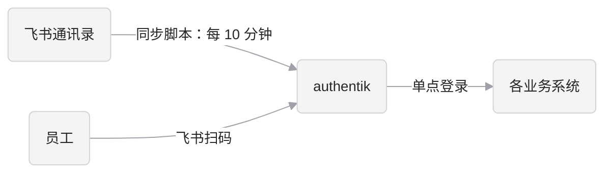

# 飞书接入 authentik

本文说明如何把飞书接入 authentik，实现两件事：

- **扫码登录**：员工用飞书扫码登录 authentik，再通过 authentik 单点登录到各个系统。
- **通讯录同步**：同步脚本每 10 分钟把飞书通讯录同步到 authentik。入职自动建号，部门自动变成用户组，离职或冻结自动禁用。

authentik 本身的部署、安全加固和运维见 [authentik.md](authentik.md)。

本文针对飞书中国版（`feishu.cn`）。海外版 Lark 使用 `larksuite.com` 域名，接口地址不同，本文未验证。

## 0. 文档状态

以下内容尚未在真实飞书租户上验证，上线前（生产环境部署好、正式通知员工之前）要逐项确认：

| 内容 | 状态 | 验证方法 |
|---|---|---|
| 扫码登录（v3 token 接口配合飞书 userinfo 接口） | 未在真实飞书租户上测试 | 配置后先用自己的账号扫码登录，失败时按第 3 节换成 v2 接口排查 |
| 同步脚本 | 只用模拟的飞书和 authentik 接口测过 | 用真实通讯录跑 `--dry-run`，逐条核对用户名、部门层级和待禁用名单 |
| 飞书权限的英文名称 | 未逐项核对 | 和飞书开放平台权限管理页面对照 |
| 飞书是否接受 `http://localhost` 作为重定向 URL | 未验证 | 本地验证时按第 4 节尝试 |
| 3.5 节防冒用策略 | 已在本地 authentik 上验证策略结果，未在真实飞书登录中验证 | 用一个邮箱前缀为 `akadmin` 的测试飞书账号扫码，应被拒绝 |
| 同步任务的告警 | 告警规则已写在 deploy-acs.md，尚未配置 | 部署时按 deploy-acs.md 7.4 节配置，并故意让一次运行失败来测试 |

## 1. 整体流程



两条链路通过**用户名**关联：

1. 同步脚本先在 authentik 里建好账号，用户名是邮箱前缀，例如 `charles.shao`。
2. 员工第一次扫码时，authentik 按同样规则算出用户名，找到脚本建好的账号并绑定。
3. 之后都按飞书的 open_id 识别，登录不会改写用户名和资料。

所以**扫码登录的属性映射和同步脚本必须使用完全相同的用户名规则**，否则员工扫码后找不到自己的账号。

authentik 不允许扫码自动注册，只有同步脚本建过号的人才能登录。这保证了外部人员即使扫码也进不来。

## 2. 创建飞书应用

登录和通讯录同步共用一个“企业自建应用”，需要飞书管理员权限。

1. 在 [飞书开放平台](https://open.feishu.cn/app) 创建企业自建应用，记下 App ID 和 App Secret。
2. 在“权限管理”里开通权限：

   | 用途 | 权限 |
   |---|---|
   | 扫码登录 | `contact:user.email:readonly`、`contact:user.employee_id:readonly` |
   | 通讯录同步 | `contact:contact.base:readonly`、`contact:department.base:readonly`、`contact:department.organize:readonly`、`contact:user.base:readonly`、`contact:user.department:readonly`、`contact:user.employee:readonly` |

3. 通讯录权限范围选“全部成员”（读取根部门要求是全部成员），应用可用范围也选全员。不在应用可用范围内的员工无法扫码登录。
4. 在“安全设置”里添加重定向 URL：`https://auth.company.com/source/oauth/callback/feishu/`。末尾的 `feishu` 对应第 3 节里 source 的 Slug。
5. 可选：添加“网页应用”能力，主页填 `https://auth.company.com/if/user/`。员工可以在飞书工作台一键打开应用门户。
6. 创建版本并发布，等管理员审核通过后才生效。之后修改权限也要重新发布版本。

App Secret 的管理：

- 只保存在 authentik 的飞书 source 和 Secret `iam-passport-feishu-sync` 里，不要发到群里或提交到仓库。
- 泄露后立即在飞书开放平台重置，并同步更新这两处配置。
- 应用的权限范围变更要走变更管理。范围被误改成部分成员时，同步脚本会以为其他人都离职了（脚本有批量禁用保护，见第 5 节）。

## 3. 配置扫码登录

### 3.1 创建飞书 source

位置：authentik 管理后台 → Directory → Federation and Social login → Create → **OpenID OAuth Source**。

| 字段 | 值 |
|---|---|
| Name | `飞书` |
| Slug | `feishu` |
| Consumer key / secret | 飞书应用的 App ID / App Secret |
| Scopes | `* contact:user.email:readonly contact:user.employee_id:readonly` |
| Authorization URL | `https://accounts.feishu.cn/open-apis/authen/v1/authorize` |
| Access token URL | `https://accounts.feishu.cn/oauth/v3/token` |
| Profile URL | `https://passport.feishu.cn/suite/passport/oauth/userinfo` |
| Authorization code authentication method | Include the client ID and secret as request parameters |
| User matching mode | 按用户名关联（`username_link`） |
| Enrollment flow | 留空 |
| Authentication flow | `default-source-authentication` |

注意事项：

- **认证方式必须改**：飞书要求 `client_id` 和 `client_secret` 放在请求体里。authentik 默认用 HTTP Basic，同时用两种方式时飞书会报 20070 错误。
- **v3 token 接口尚未在真实租户上验证**：飞书已经把 v2 token 接口标为废弃，所以表里填的是 v3。如果扫码后报错，先把 Access token URL 换成 `https://open.feishu.cn/open-apis/authen/v2/oauth/token` 排查。
- **Enrollment flow 必须留空**：这样只有同步脚本建过号的人才能登录。
- 飞书的用户信息地址恰好是 `passport.feishu.cn`，排查日志时注意和本仓库名 `iam-passport` 区分。

### 3.2 属性映射

位置：Customization → Property Mappings → Create → OAuth Source Property Mapping，然后挂到飞书 source 上。

用户名规则必须和同步脚本的 `username_of()` 函数一致：

```python
email = (info.get("email") or "").lower()
return {
    "username": email.split("@")[0] if email else info.get("user_id"),
    "name": info.get("name"),
    "email": email or None,
}
```

修改用户名规则时，必须同时修改这里和 `org-sync/feishu/feishu_authentik_sync.py`，并评估对已有账号的影响。

### 3.3 在登录页显示飞书按钮

Flows → `default-authentication-flow` → Stage Bindings → 编辑识别步骤（identification stage）→ 在 Sources 里加上飞书。保存后登录页就会出现飞书按钮。

只想让员工扫码登录、不显示用户名密码输入框时，可以在识别步骤里清空 User fields。但管理员和应急账号仍需要密码登录，建议保留输入框，或另建一个只给管理员用的登录流程。

### 3.4 验证

1. 用一个已经被同步脚本建好账号的员工扫码，应能直接登录，并看到应用门户。
2. 在 Directory → Users 里打开这个员工，应能看到他已关联飞书 source。
3. 用一个不在通讯录里的飞书账号（或没有被同步的账号）扫码，应登录失败。

### 3.5 防止扫码冒用手工账号

“按用户名关联”有一个隐患：authentik 只看用户名，不看这个账号是不是同步脚本建的。如果某个飞书账号的邮箱前缀恰好是 `akadmin` 或某个服务账号的用户名（比如飞书管理员误建或恶意创建了 `akadmin@company.com`），这个人扫码就能直接登录到那个手工账号上。

对策是在飞书登录的流程（`default-source-authentication`）里，登录步骤之前加一个拒绝步骤，只对没有 `feishu_managed` 标记的账号生效。

这个配置已经写成 blueprint：`deployments/chart/blueprints/feishu-only-managed-users.yaml`。生产环境随 Helm chart 发布后由 worker 自动应用，不需要在后台手工配置，也不要在后台修改。本地验证时的应用方法见 [deploy-acs.md 7.5 节](deploy-acs.md#75-用-blueprints-管理配置)。

应用后在 Flows → `default-source-authentication` → Stage Bindings 里能看到排在最前面的 `feishu-only-managed-users-deny`，它绑定了策略 `feishu-only-managed-users`：

```python
user = request.context.get("pending_user")
return not (user and user.attributes.get("feishu_managed"))
```

这样 `akadmin`、应急管理员和服务账号都只能用密码登录。验证方法见第 0 节。

## 4. 本地验证

先在本地 Docker 上验证扫码登录和同步，再上生产。本地 authentik 的启动方法见仓库根目录的 `README.md`。

- **重定向 URL**：在飞书应用里额外添加 `http://localhost:9000/source/oauth/callback/feishu/`。回调只经过员工的浏览器，飞书服务器不需要能访问你的电脑。
- **飞书不接受 localhost 时**：用 ngrok 这类工具给本机开一个 https 临时域名，把重定向 URL 和 `authentik/.env` 里的 `AUTHENTIK_WEB__BASE_URL` 都改成这个域名，然后重启 authentik。
- **本地同步**：本地 authentik 可以随时清空重建，可以放心用真实通讯录试。服务账号在本地可以直接加入 `authentik Admins` 组，生产环境必须按第 5 节只给最小权限。
- 验证完成后，从飞书应用里删除本地的重定向 URL。

## 5. 部署同步脚本

脚本在 `org-sync/feishu/feishu_authentik_sync.py`，只依赖 `requests`。

### 5.1 准备 authentik 服务账号

1. Directory → Users → Create Service account，例如 `svc-feishu-sync`。
2. 建一个角色并分配给它。角色需要：
   - 用户：查看、新增、修改
   - 组：查看、新增、修改
   - 登录会话（Authenticated Session）：查看、删除
3. 不要把服务账号放进 `authentik Admins` 组。
4. Directory → Tokens → Create，User 选这个服务账号，Intent 选 **API**。创建时注意过期设置，见第 6 节。

### 5.2 部署

生产环境以 Kubernetes CronJob `feishu-sync` 的形式运行，和 authentik 在同一个 Helm release 里，由 Jenkins 流水线构建镜像并发布。脚本通过集群内地址访问 authentik，API token 不经过 ALB。部署文件是 `deployments/chart/templates/feishu-sync.yaml` 和 `deployments/feishu-sync.Dockerfile`。

创建 Secret、开启 CronJob、手动触发试运行的命令见 [deploy-acs.md 第 5 节](deploy-acs.md#5-启用飞书同步)。

CronJob 的设置：

| 设置 | 值 | 作用 |
|---|---|---|
| `schedule` | `*/10 * * * *` | 每 10 分钟运行一次 |
| `concurrencyPolicy` | `Forbid` | 上一次还没跑完时不启动新的一次，防止两次同时写入 |
| `activeDeadlineSeconds` | 540 | 单次运行超过 9 分钟就终止，不影响下一次 |
| `backoffLimit` | 0 | 失败不重试，等下一次定时运行 |

日志通过 SLS 采集，保存至少 6 个月。告警规则见 [deploy-acs.md 7.4 节](deploy-acs.md#74-监控和告警)。

### 5.3 试运行

新开启的 CronJob 默认带 `--dry-run` 参数，只打印将要做的变更，不写入任何数据。第一次运行时逐条核对：

- 用户名是否都是邮箱前缀，有没有重名导致的冲突。
- 部门组的层级和名称是否和飞书一致。
- 没有邮箱的员工有多少，这些人的用户名会是飞书 user_id。
- 待禁用名单是否合理。

核对无误后再关闭试运行。本地验证时也可以直接运行脚本，方法见仓库根目录的 `README.md`。

### 5.4 脚本的行为

| 场景 | 脚本的处理 |
|---|---|
| 新员工 | 新建账号。用户名是邮箱前缀转小写；没有邮箱时用飞书 user_id。账号默认没有密码 |
| 姓名或邮箱变化 | 更新 authentik 里的姓名和邮箱。用户名不变 |
| 部门 | 每个部门对应一个组，命名为 `飞书/技术中心/运维组`。上级部门的组包含所有下级部门的人 |
| 部门改名 | 组名跟着改 |
| 部门删除 | 清空组成员，但不删除组 |
| 离职或冻结 | 禁用账号，并踢掉 authentik 里的登录会话 |
| 冻结后解冻 | 自动恢复。只恢复被脚本自己禁用的账号，管理员手动禁用的不会恢复 |
| 离职后重新入职 | 飞书通常会分配新的 user_id，新账号和旧账号的用户名冲突。脚本不自动合并，报错并说明旧账号的 user_id。管理员确认是同一个人后，把旧账号 attributes 里的 `feishu_user_id` 改成新值，下次同步自动恢复 |
| 用户名被占用 | 不建号，报错说明被手工账号还是被哪个飞书账号占用 |
| 飞书接口偶发错误（断连、限流、5xx） | 自动重试，最多 3 次 |
| 飞书接口持续报错 | 在写入任何数据前退出 |
| 某一项写入 authentik 失败 | 记录下来，继续处理其他人和组，最后以非 0 退出码结束，触发告警 |
| 一次要禁用超过 5 个且超过 10% 的账号 | 直接中止，防止通讯录权限范围被误改后把全员禁用 |

脚本只处理带 `feishu_managed` 标记的用户和组，不会动手工创建的账号（如 `akadmin`、服务账号）和手工维护的角色组。

离职有最多 10 分钟的延迟。紧急情况直接在 authentik 里手动禁用。需要秒级生效时，可以订阅飞书的员工离职事件 `contact.user.deleted_v3` 来触发脚本。

### 5.5 运行测试

修改脚本后，先跑模拟测试（不需要网络和依赖）：

```bash
python3 org-sync/feishu/test_sync.py
```

测试覆盖：试运行、首次建号、重复运行、改名、离职、冻结后解冻、离职后以新 user_id 重新入职、飞书接口报错、飞书接口偶发错误重试、获取 token 失败、用户名冲突时继续处理其他人并以非 0 退出、批量误禁用保护。

同步脚本访问通讯录用的是飞书标准的应用凭证（`tenant_access_token/internal` 接口），和扫码登录用的 OAuth token 接口是两回事。

## 6. 风险和对策

| 风险 | 后果 | 对策 |
|---|---|---|
| authentik API token 过期 | 脚本持续报错，入职不建号、离职不禁用，可能长时间没人发现 | 创建 token 时确认过期设置。设为不过期时，每半年手动轮换一次并设日历提醒；设了过期时间时，在到期前轮换 |
| 两次运行重叠 | 两个进程同时写入，可能互相覆盖组成员 | CronJob 设置 `concurrencyPolicy: Forbid`，见 5.2 节 |
| 同步长时间没有成功运行 | 入职不建号、离职不禁用，没有任何报错 | 监控 CronJob 最近一次成功的时间，超过 30 分钟就告警 |
| 脚本出错或部分写入失败 | 新员工没建号，或离职员工没被禁用 | 脚本会以非 0 退出码结束并列出每一项失败；CronJob 失败时告警，比如发到飞书群机器人 |
| 邮箱被复用 | 离职员工的邮箱分配给了新同事，两人的用户名相同。如果直接把旧账号改绑给新人，新人会继承旧员工在各系统里的账号和数据 | 公司规定企业邮箱不回收复用。脚本遇到这种情况只报错、不合并；管理员要为新人换一个邮箱 |
| 邮箱前缀重名 | 两个人邮箱前缀相同（如不同邮箱域名下都叫 `zhang`）时，后来的人建号失败 | 确认公司只使用一个邮箱域名；有多个域名时，修改用户名规则，并同步修改 3.2 节的属性映射 |
| 员工在第一次扫码前改了邮箱 | 扫码时用户名对不上，登录失败 | 管理员在 authentik 里把用户名改成新的邮箱前缀。第一次扫码之后再改邮箱不受影响 |
| 用户名和手工账号冲突 | 员工的邮箱前缀和 `akadmin`、应急管理员等手工账号相同时，建号失败；更严重的是这个人可能通过扫码登录到手工账号上 | 手工账号的用户名不要使用可能和员工重名的名字，并配置 3.5 节的防冒用策略 |
| 飞书通讯录权限范围被误改 | 脚本以为大量员工离职 | 脚本已有批量禁用保护；权限范围变更纳入变更管理 |
| 用户在 authentik 里修改了姓名或邮箱 | 下次同步时被覆盖 | 在 authentik 系统设置里关闭用户修改姓名、邮箱、用户名 |

### 6.1 飞书账号安全

员工扫码登录后就能进入所有接入的系统，所以**飞书账号的安全等于整个平台的安全**。飞书账号被盗，攻击者就能以这个员工的身份登录 GitLab、Grafana 等系统。

- **强制二次验证**：在飞书管理后台对全员开启登录二次验证，并开启新设备登录提醒。
- **控制飞书管理员**：飞书管理员可以修改员工的邮箱、创建新账号，间接决定 authentik 里的用户名。飞书管理员人数要少，操作要有审计。
- **高危系统再加一层 MFA**：JumpServer、authentik 管理后台等高危系统，要求员工在扫码之后再通过 authentik 自己的 MFA，配置方法见 [authentik.md 5.1 节](authentik.md#51-高危应用要求二次-mfa)。
- **邮箱不复用**：企业邮箱不回收给新员工，原因见上表。

### 6.2 飞书故障的影响

员工只能用飞书扫码登录，所以飞书开放平台或飞书登录故障时：

- 已经登录的系统，在会话过期前不受影响。
- 新的登录全部失败，包括会话过期后需要重新登录的人。
- 通讯录同步会报错退出，不会误禁用任何人。

应对方式：

- authentik 的会话有效期按工作日设置（如 8 到 12 小时），避免故障期间大量会话同时过期。
- 管理员和应急账号用本地密码加 MFA 登录，不受飞书故障影响，见 [authentik.md 7.3 节](authentik.md#73-应急通道)。
- 如果需要关键岗位在飞书故障时也能登录，提前给这些人设置 authentik 本地密码和 MFA，并在登录页保留用户名密码输入框。

## 7. 常见问题

**扫码后报 20070 错误**

Authorization code authentication method 没有改成 “Include the client ID and secret as request parameters”。见 3.1 节。

**扫码后提示登录失败，或者跳到了注册页面**

- 这个员工还没有被同步脚本建号：检查他是否在飞书应用的可用范围内，以及同步脚本最近是否成功运行。
- 用户名对不上：在 Directory → Users 里搜索这个员工，确认用户名是否等于他飞书邮箱的前缀。
- 属性映射没有挂到飞书 source 上，或者规则和同步脚本不一致。见 3.2 节。

**员工能登录 authentik，但看不到某个应用**

应用的绑定里没有包含他所在的部门组或角色组。部门组由同步脚本维护，不要手工往部门组里加人；需要例外授权时用角色组。见 [authentik.md 第 5 节](authentik.md#5-权限设计)。

**员工用 JumpServer、VPN 时提示密码错误**

同步脚本建的账号默认没有密码。员工要先在 authentik 的个人设置里设置密码。

**同步脚本报“本次要禁用 N 个账号，超过阈值，已中止”**

先确认飞书应用的通讯录权限范围有没有被改动。确实是批量离职或组织调整时，先人工核对名单，再临时运行一次（保护阈值在脚本的 `MAX_DISABLE_RATIO` 里）。

## 8. 上线检查清单

- [ ] 第 0 节的待验证项已全部确认
- [ ] 飞书应用的权限、通讯录范围、可用范围和重定向 URL 已配置并发布
- [ ] 本地验证用的 localhost 重定向 URL 已删除
- [ ] 飞书 source 的认证方式已改为请求参数
- [ ] Enrollment flow 为空，未同步的账号无法扫码登录
- [ ] 属性映射的用户名规则和同步脚本一致
- [ ] 已确认公司只使用一个邮箱域名，或已调整用户名规则
- [ ] 手工账号（`akadmin`、应急管理员、服务账号）的用户名不会和员工重名
- [ ] 同步脚本的服务账号只有必要权限，token 过期时间已记录
- [ ] 同步脚本 `--dry-run` 输出已人工核对
- [ ] CronJob 已关闭试运行模式，运行失败和“30 分钟未成功”的告警已配置并测试
- [ ] 已关闭用户在 authentik 里修改姓名、邮箱、用户名
- [ ] 已用三类账号验证扫码登录：已同步的员工、未同步的账号、已离职的员工
- [ ] 已配置 3.5 节的防冒用策略，并用测试账号验证手工账号无法通过扫码登录
- [ ] 飞书已对全员开启登录二次验证，飞书管理员名单已复核
- [ ] 公司已明确企业邮箱不回收复用
